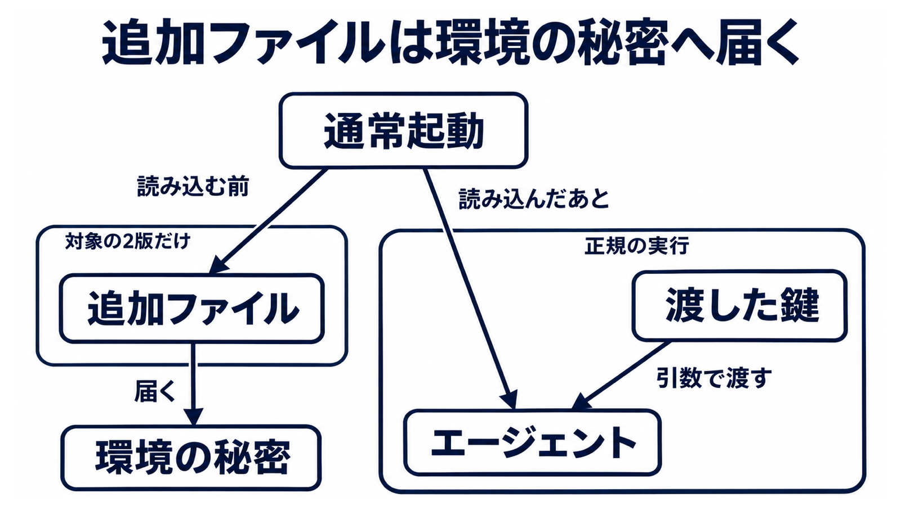

# ダイジェスト: 対象2版は読み込む前に環境の秘密へ届く

[元記事](../../../../../articles/microsoft-agent-framework-p2_20261120.md)

## ひとことで言うと

agent-framework の 1.26.1 と 1.26.2 は、起動時に資格情報を集めて外へ送る版です。

## 核心ポイント

- 2026-11-20 の正規最新は 1.26.0 です。対象は同じ配布名の 1.26.1 と 1.26.2 だけです。
- 対象版は、通常起動でアプリが読み込む前に動く追加ファイルを足します。対象版の依存先は、1.26.0 のままです。
- 同じユーザーの環境変数とファイル、他プロセス、クラウドの窓口を集め、外へ送ります。
- 1.26.2 は、GitHub Actions のジョブ権限で短命トークンを取りに行けます。
- レジストリの最新が 1.26.0 でも、ロックやイメージは別に残ります。

## メンタルモデル

左の矢印は、通常起動から追加ファイルへ向かいます。右の枠は、正規の実行です。

## 具体例

版情報の名前が agent-framework で、版が 1.26.1 か 1.26.2 なら対象です。

## 適用と判断

向く場面:

- 同じ配布名を入れた Python 環境を点検するときです。
- クラウドの計算資源で、対象版を起動したときです。
- 同じアカウントで、人の資格情報ファイルが見えるときです。

確認すること:

- 調べて除き、再発行が終わるまで、その Python を起動していませんか。
- 対象版を、記録してから除きますか。
- 対象版を入れたか、その Python を起動したホストの秘密を再発行しますか。
- 戻す先を、1.26.0 のハッシュで固定しますか。
- インストール用ジョブに、本番の権限が無いか。

## 限界・注意点

- 後継の修正版は、アドバイザリ上ありません。
- 再発行は、変数名の部分一致だけでは絞りません。
- 追加コードとは別に、従来どおり動くかは未確認です。
- アプリがメモリ上だけに渡した値を読む経路は、収集対象に書かれていません。
- 他言語の別の改ざんは、未確認です。

## 参考

- 元記事: [microsoft-agent-framework-p2_20261120.md](../../../../../articles/microsoft-agent-framework-p2_20261120.md)
- [GHSA-764m-3ppc-5m73](https://github.com/advisories/GHSA-764m-3ppc-5m73)
- [OSV MAL-2026-20101](https://osv.dev/vulnerability/MAL-2026-20101)
- [PyPI JSON agent-framework](https://pypi.org/pypi/agent-framework/json)
- [Microsoft Learn Agent Framework 概要](https://learn.microsoft.com/en-us/agent-framework/overview/)
