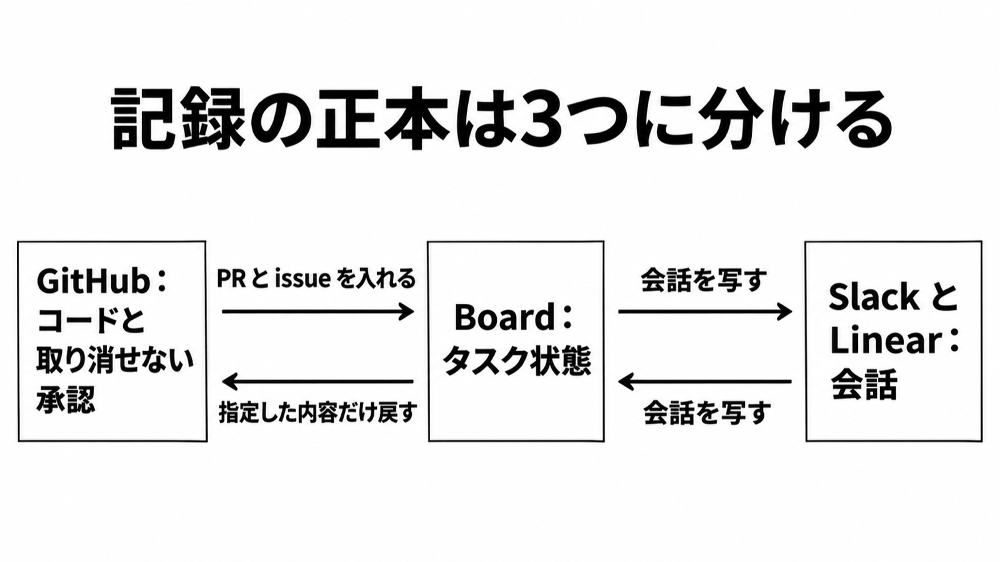

# ダイジェスト: タスク状態は共有ログに留める

[元記事](../../../../../articles/vercel-board-vercel-introducing-p5_20261120.md)

## ひとことで言うと

Vercel の Board は、複数の実行環境が同じタスク状態を読む共有ログです。

## 核心ポイント

- 同じタスクを取れるのは 1 件だけです。
- 依存している次のタスクは、前が失敗または取り消されると待ちのままです。
- 取ったタスクを持っていられる長さを 1 時間と指定しても、Vercel 上の Board が渡すのは 5 分までです。
- GitHub の既定は、PR と issue を Board へ入れる向きです。戻るのは、戻すと指定した内容だけです。
- preview（検証用の配備）は、最初から Slack、GitHub、Linear へ、相手の利用者として書けます。

## メンタルモデル

左が GitHub、中央が Board、右が Slack と Linear です。矢印のラベルが、写す向きと条件です。

## 具体例

長い計画は、複数回の書き込みに分かれます。先に書いた分は、続きが書き終わる前に取られることがあります。

## 適用と判断

向く場面:

- 持っていられる期限のあと、別の実行環境が取ります。
- 会話の到達をチャット側の写しで見ます。

確認すること:

- 取り消せない承認は GitHub のレビューに置きますか。
- 渡された、持っていられる長さを見ますか。
- タスクの本文を書ける相手は、本番環境と名前を指定した人だけですか。
- 公開の Slack に繋ぐチャネルは、公開してよい内容ですか。

## 限界・注意点

- 長さが切れたあとは、次に取るか一覧するまで、持ったままの表示が残ります。
- 実験提供です。データの喪失がありえ、提供を続ける義務はありません。
- 人の確認待ちでは、返信した人の承認権限を API が確かめません。
- 保存先は米国のみです。

## 参考

- 元記事: [vercel-board-vercel-introducing-p5_20261120.md](../../../../../articles/vercel-board-vercel-introducing-p5_20261120.md)
- [Introducing Vercel Board](https://vercel.com/blog/introducing-vercel-board)
- [Board 概要](https://vercel.com/docs/board)
- [同期](https://vercel.com/docs/board/concepts/sync)
- [Public Beta Agreement](https://vercel.com/docs/release-phases/public-beta-agreement)
