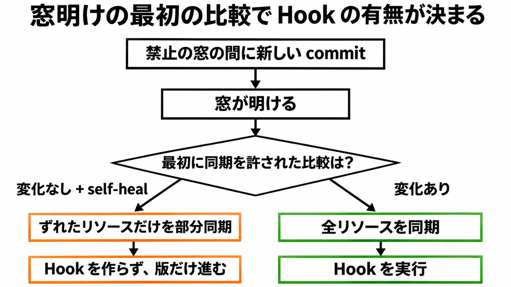

# ダイジェスト: 同期窓の後に移行 Hook が飛ぶ条件

[元記事](../../../../../articles/argo-cd-hook-gitops-cncf-p3_20261121.md)

## ひとことで言うと

Argo CD は同期窓の後、self-heal が DB 移行の Hook を飛ばしても正常に見えることがあります。

## 核心ポイント

- 同期を禁じる窓の間も比較は続き、新しい commit の SHA がアプリの状態欄に書かれます。
- 窓明けに、その状態欄の SHA と比べる比較が先に来ると、一致して「変化なし」になります。
- 直前の同期が成功なら、self-heal（自動修復）はずれた分だけを指定して同期します。この部分同期は Hook（同期の特定段階で流すリソース）を作りません。
- Hook は Synced・Healthy の判定に含まれません。通常のリソースが Git と一致すれば、表示は正常になりえます。
- 部分同期でも、最後に適用した版の記録は進みます。そのため、周期的な再比較を待っても Hook は走りません。

## メンタルモデル

上から読み、窓明けの分岐で左右に分かれます。左が Hook を飛ばす経路、右が Hook を実行する経路です。

## 具体例

CNCF Blog の顧客事例では、5 つの region のうち 2 つで移行が走りませんでした。

## 適用と判断

向く場面:

- 同期窓・self-heal・Hook での DB 移行を併用するときです。

確認項目:

- 直近の操作の対象指定（`sync.resources`）は空ですか。
- 同期履歴に、出した commit が記録されていますか。
- スキーマの版は、リリースの期待値ですか。
- Job を通常のリソースにするか、self-heal を切るか決めましたか。

## 限界・注意点

- どちらの比較が先に来るかは毎回変わります。最新 commit を取り直す比較が先なら、通常は Hook が走ります。
- 事例は CNCF Blog の報告で、Argo CD の版は不明です。分岐は v3.6.2 のソースの読解です。
- Hook の種別変更、窓の短縮、未マージの修正案のどれでも、この経路は残ります。
- self-heal を切ると、次の全体同期まで OutOfSync と手動のずれが残ります。
- 移行 Job を通常のリソースにすると部分同期の対象に入りますが、版ごとの Job 名と再実行手順を自分で持ちます。

## 参考

- 元記事: [argo-cd-hook-gitops-cncf-p3_20261121.md](../../../../../articles/argo-cd-hook-gitops-cncf-p3_20261121.md)
- [CNCF Blog（Afzal Ansari, 2026-11-20）](https://www.cncf.io/blog/2026/11/20/when-a-sync-window-closes-how-argo-cd-self-heal-skipped-the-migration-hook/)
- [Argo CD v3.6.2 controller/appcontroller.go](https://github.com/argoproj/argo-cd/blob/v3.6.2/controller/appcontroller.go)
- [Argo CD v3.6.2 controller/sync.go](https://github.com/argoproj/argo-cd/blob/v3.6.2/controller/sync.go)
- [argoproj/argo-cd#26044](https://github.com/argoproj/argo-cd/pull/26044)
