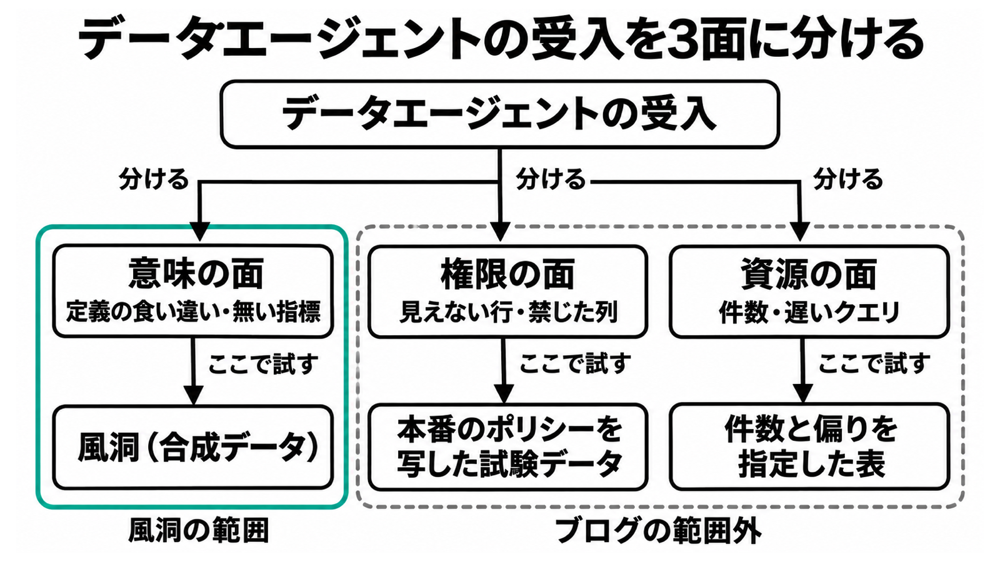

# ダイジェスト: データエージェントを試す「風洞」と受入の3面

[元記事](../../../../../articles/cloud-google-products-data-p9_20261121.md)

## ひとことで言うと

Google Cloud が社内で使う「風洞」は、データエージェントの意味の誤りを本番に繋がずに試す仕組みです。

## 核心ポイント

- 風洞は、短い組織の説明文から架空の会社を作ります。表、社内のメモやチャット、難しい問い、正解を一式で作ります。
- 何が真かを最初に固定します。表と正解 SQL は、乱数の種から毎回同じに作ります。
- エージェントが使えるのは、読み取り SQL、スキーマ閲覧、メモやチャットの検索だけです。正解は見えません。
- 試すのは、定義の食い違い、重複行、無い指標に答えないか、といった意味の誤りです。

## メンタルモデル

上から受入を3つの面に分け、下段が試す場所です。緑の枠が風洞の試す範囲で、点線の枠は風洞が試すか不明な範囲です。

## 具体例

架空のブレーキ会社で、欠陥件数を問います。正解は、重複行を除いた 240 です。重複を数える SQL や、公式定義と違う現場の監督の数え方に従う SQL は、別の数になります。

## 適用と判断

向く場面:

- 公式定義と現場の定義がずれる指標を試すときに向きます。
- 開発者が本番データに触れられないときに向きます。

確認項目:

- 受入の問いを、意味・権限・資源に仕分けましたか。
- 権限は、行と列のポリシーを付けた試験データで試しましたか。
- 権限の合格条件を、エラーの有無とは別に書きましたか。
- 公式定義を、指標の所有者が承認しましたか。
- 正解をプロンプトと学習データから外しましたか。

## 限界・注意点

- 風洞の製品、API、料金は公開されていません。使うなら同じ作り方を自作します。
- 公開された検証は、推論を深くするなどの変更で、精度の上下と順位が人手の試験と揃った、までです。
- 行フィルタ、列マスク、本番に無い結合の検出、遅いクエリを風洞が試すかは不明です。
- BigQuery では、行ポリシーの対象外の利用者のクエリが 0 行で成功します。
- 仕込んだ乱れ方への慣れと、実業務からのずれが残ります。実地と合わせる頻度の定めはありません。

## 参考

- 元記事: [cloud-google-products-data-p9_20261121.md](../../../../../articles/cloud-google-products-data-p9_20261121.md)
- [Frontier and Center: Why your data agents need a “wind tunnel”（Google Cloud Blog、2026-11-21）](https://cloud.google.com/blog/products/data-analytics/a-data-simulator-to-test-agents/)
- [BigQuery: Use row-level security with other BigQuery features](https://docs.cloud.google.com/bigquery/docs/using-row-level-security-with-features)
- [Conversational Analytics API: Connect to BigQuery](https://docs.cloud.google.com/gemini/data-agents/conversational-analytics-api/connect-bigquery)
