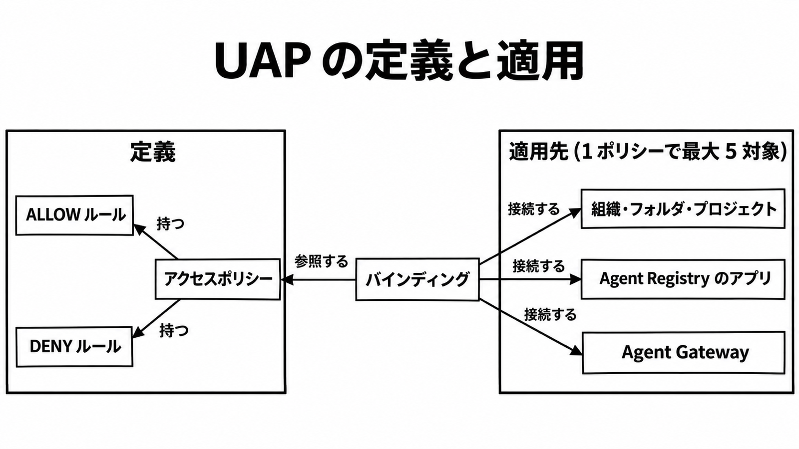

# ダイジェスト: Unified Access Policies (UAP) の試し方

[元記事](../../../../../articles/cloud-google-products-identity-p2_20261121.md)

## ひとことで言うと

Google Cloud IAM の UAP は、許可と拒否を 1 つのポリシーに書き、バインドした対象に効かせます。

## 核心ポイント

- ポリシーは、バインディング（対象への接続）が指したプロジェクトなどと、その子孫にだけ効きます。
- UAP は既存の allow・deny ポリシーと併せて評価され、deny が先に効きます。祖先の deny は子孫の allow でも消えません。
- ポリシーごとの公式上限は、主体 500、バインド先 5 です。告知ブログのバインド先 25 は公式上限ではありません。
- AI エージェントが外部ツールへ出る通信の権限だけなら、ポリシーは GA です。データアクセスの権限を含むと Preview です。

## メンタルモデル

左のポリシーがルールを持ち、中央のバインディングが右の対象へ接続します。Agent Gateway は、エージェントの通信を仲介する対象です。

## 具体例

テスト用プロジェクトに、ポリシーを 2 つ分けて置きます。

| ポリシー | 中身 | 扱い |
|---|---|---|
| データ用 | リソースタグを条件にした権限のルールです | 本番の緊急遮断に使いません |
| ツール通信用 | 外部ツール通信の権限 `egressViaIAP` だけです | まず dry-run（判定の記録だけ）で動かします |

## 適用と判断

向く場面:

- テスト用プロジェクトで、UAP を先に試すときです。
- エージェントのツール通信だけを、先に確かめたいときです。

確認すること:

- 既存の allow と deny を残しましたか。
- データアクセスの GA など見直し条件が揃うまで、全社の権限を移さずにいますか。
- ツール通信用を dry-run に戻すかバインドを外す手順を、先に書きましたか。

## 限界・注意点

- Policy Troubleshooter（許否の理由の診断）は UAP を説明しません。祖先のバインディングを手で見ます。
- カスタムロールは、ルールから参照できません。
- 組織のポリシーで UAP のバインドを禁止しても、既存の適用は残ります。
- データアクセスを含む UAP は Pre-GA の条項で、予告なく変更・停止され得ます。
- 許可・拒否の判定ログにポリシー名が残るかは不明です。

## 参考

- 元記事: [cloud-google-products-identity-p2_20261121.md](../../../../../articles/cloud-google-products-identity-p2_20261121.md)
- [How to simplify cloud access with Unified Access Policies, now in preview（2026-11-20）](https://cloud.google.com/blog/products/identity-security/how-to-simplify-cloud-access-with-unified-access-policies/)
- [Unified Access Policies](https://docs.cloud.google.com/iam/docs/unified-access-policies)
- [Create and apply Unified Access Policies](https://docs.cloud.google.com/iam/docs/unified-access-policies-create-apply)
- [IAM Quotas and limits](https://docs.cloud.google.com/iam/quotas)
