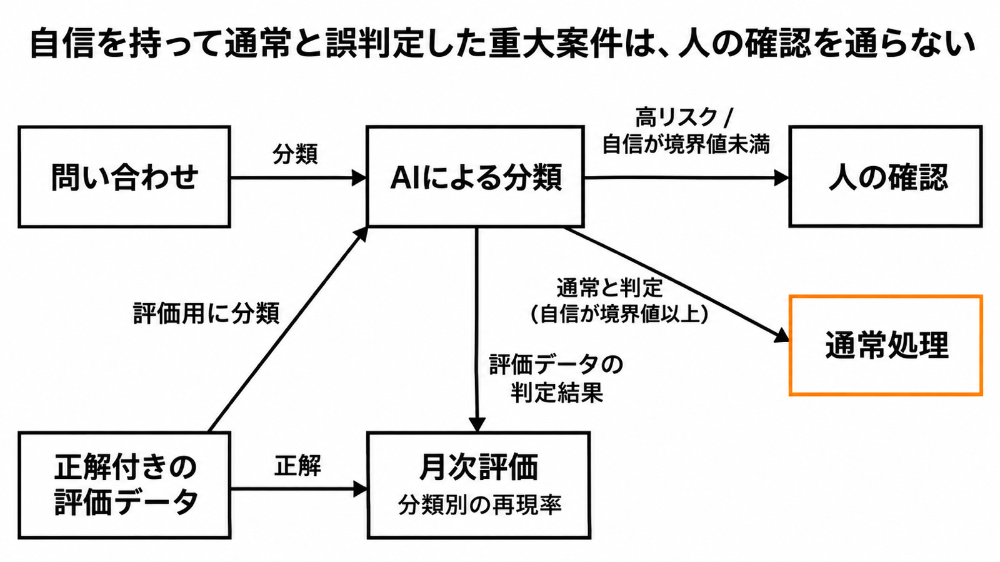

# ダイジェスト: IPA「AI時代の要求管理ハンドブック」を問い合わせ分類で読む

[元記事](../../../../../articles/ipa-ai-req-mgmt-handbook_20261121.md)

## ひとことで言うと

IPA の要求管理ハンドブックを、問い合わせ分類 AI の受入条件と要求の承認に当てはめた記事です。

## 核心ポイント

- ハンドブックは、困りごとを「要望」、実現したいことを「要求」、確かめ方を「要件」と書き分けます。
- ハンドブックにある再現率90%は、要件の書き方を示す例です。受入の値は、許せる誤りを現場と話して決めます。
- 「AI が高リスクと分類したら人が確認」だけでは、AI が通常と誤判定した重大案件が確認から漏れます。分類別の再現率で、この見逃しに気付きます。
- 要求整理を手伝う AI が会議記録から抽出した要求文は、候補です。人が承認した版（ベースライン）を、以後の変更の基準にします。

## メンタルモデル

図の「自信」は、AI が分類結果をどの程度確かとみるかを示す値です。下段の月次評価は、評価データでの AI の判定結果を正解と照らし、分類別の再現率を測ります。

## 具体例

重大案件 10 件のうち 9 件を拾えば、重大案件の再現率は 90% です。

## 適用と判断

向く場面:

- AI の受入条件を、精度の数字 1 つで合意しかけているときです。
- AI 導入と受付フォームの変更などの別の手段を、同じ要求で比べるときです。

確認すること:

- AI が判断を保留した重大案件も、拾えなかった件に数えますか。
- AI が高リスクと分類した案件は、全件を人が確認しますか。
- 「重大案件」の範囲を変えたら、評価データの正解と人の確認条件をたどれますか。

## 限界・注意点

- 月次評価は、個々の見逃しを救済しません。見逃しを許せない業務では、受付の設計も検討対象にします。
- ハンドブックは、要求管理の予算にプロジェクト総コストの2〜5%を示します。これは出発点で、手戻りや影響調査の時間を見て調整します。
- 自信の境界値の決め方は、記事に書かれていません。

## 参考

- 元記事: [ipa-ai-req-mgmt-handbook_20261121.md](../../../../../articles/ipa-ai-req-mgmt-handbook_20261121.md)
- [IPA「AI時代の要求管理ハンドブック」公開ページ](https://www.ipa.go.jp/digital/kaihatsu/youkyu-kanri.html)
- [IPA「AI時代の要求管理ハンドブック」Ver.1.0.0（PDF）](https://www.ipa.go.jp/digital/kaihatsu/rqr7mi000000f5up-att/req-mgmt-hb.pdf)
