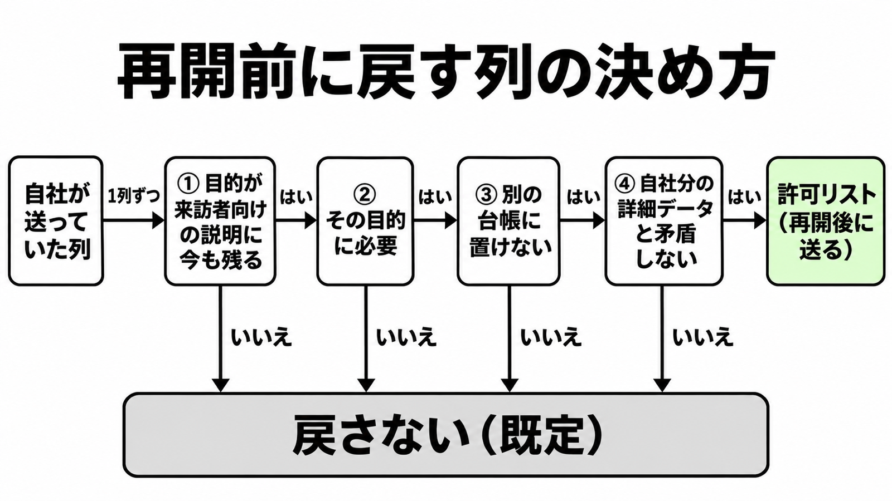

# ダイジェスト: KARTE 侵害後、再開時に送り直さない項目

[元記事](../../../../../articles/karte-plaid-co-jp-20261120-p4_20261121.md)

## ひとことで言うと

KARTE 侵害の公表を基に、再開時は既定でどの項目も送らず、条件を満たす項目だけ例外にする判断を示します。

## 核心ポイント

- プレイドのマーケティング支援ツール KARTE は、11月13日の不正アクセス以降止まっています。
- プレイドは11月24日から、自社分の詳細データ（自社の漏えい範囲の詳細）を順次渡す予定です。
- 記事は、再開時に KARTE へ送る項目を既定で「送らない」とし、例外を4条件で絞ります。
- 4条件は、目的を今も来訪者に説明・項目が必要・KARTE 以外の自社台帳で代われない・詳細データと矛盾しない、です。
- スキーマも主キーも未設定の紐付けテーブル（業務データを渡す表）は、最初に送った値で構成と主キーが決まります。

## メンタルモデル

図の「列」は送るデータ項目、「戻す」は再び送ることです。左から右へ順に判定します。

## 具体例

| 項目 | 初期判断 |
|---|---|
| 氏名・メール・電話番号 | 送りません。配信を続けるなら宛先だけ例外候補です |
| 生年月日 | 送りません。単独なら例外候補で、照合できないことを法務が文書化します |
| 顧客管理番号 | 自社データとの突き合わせに必要で、氏名やメールを鍵にしないときだけ例外候補です |

## 適用と判断

向く場面:

- KARTE の再開前に、送る項目を決めるときです。
- 計測担当と法務で、送る項目の一覧を固めるときです。

確認すること:

- 自社が KARTE へ送っていた項目の一覧を出しましたか。
- KARTE に預けた連携先の鍵を、再開を待たずに失効しましたか。
- 有効に戻す前に、計測コードと API の項目が停止前と同じか確かめましたか。

## 限界・注意点

- 記事は11月21日時点で書かれ、自社分の詳細データを反映していません。
- 削除の条項があっても、契約終了企業のデータは残っていました。
- 計測コードの項目定義は、KARTE のサポートページが取得できず未確認です。
- 再開は2027年1月中旬が目標で、変わりえます。
- 送信を止めても、預けたデータの削除・連絡・報告は別に残ります。

## 参考

- 元記事: [karte-plaid-co-jp-20261120-p4_20261121.md](../../../../../articles/karte-plaid-co-jp-20261120-p4_20261121.md)
- [プレイド「KARTEへの不正アクセスに関する調査結果およびサービス再開の見通しのお知らせ」（2026-11-20）](https://plaid.co.jp/news/20261120/)
- [同日の適時開示PDF](https://pdf.irpocket.com/C4165/xoA3/Laiu/rVla/otGG.pdf)
- [KARTE利用契約書（2024年2月15日改定版）](https://plaid.co.jp/assets/pdf/terms/KARTE%E5%88%A9%E7%94%A8%E5%A5%91%E7%B4%84%E6%9B%B8%EF%BC%882024%E5%B9%B42%E6%9C%8815%E6%97%A5%E6%94%B9%E5%AE%9A%E7%89%88%EF%BC%89.pdf)
- [KARTE Developers: 紐付け行の更新API](https://developers.karte.io/reference/post_v2beta-track-reftable-row-upsert)
