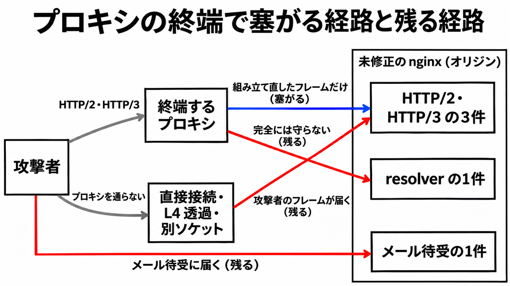

# ダイジェスト: nginx2root の5件を台帳に載せる

[元記事](../../../../../articles/nginx-waf-cloudflare-nginx2root-p5_20261121.md)

## ひとことで言うと

F5 と nginx.org が直した脆弱性5件（nginx2root）は、到達経路と修正ビルドで管理します。

## 核心ポイント

- 5件は、HTTP/2・HTTP/3・resolver・メールプロキシという別々の機能で経路になります。
- 5件に一致する WAF のシグネチャはありません。
- HTTP/2・HTTP/3 の3件は、終端するプロキシと直接接続の封鎖が揃うときだけ塞がります。
- resolver とメールの2件は、プロキシでは閉じません。オリジンの設定と待受で判断します。
- 修正済みかは、配布元が fixed と言うビルドで判断します。

## メンタルモデル

青の矢印がプロキシで塞がる経路、赤が残る経路です。別ソケットは、gRPC など別の HTTP/2 待受です。

## 具体例

Ubuntu 24.04 の修正版は `1.24.0-2ubuntu7.20` です。上流の修正版 1.30.7 より小さい番号です。番号の比較だけでは、修正済みを未修正と誤判定します。

## 適用と判断

向く場面:

- 修正版を入れるまで、何で守れるか決めるときです。
- 脆弱性台帳に、nginx のパッケージやイメージごとの行を作るときです。

確認すること:

- nginx.org 版を、系列別に 1.30.7・1.31.9 と比べましたか。
- gRPC など、別の HTTP/2 待受を洗い出しましたか。
- 修正版を入れた後、古いワーカの終了を確かめましたか。
- resolver で同じ名前の解決が内部リクエストと重ならないか確かめましたか。

## 限界・注意点

- コード実行は、ASLR（配置のランダム化）が無効か回避された場合の条件付きです。クラッシュは ASLR に関係なく起き得ます。
- Cloudflare のグローバル AOP は全アカウント共通の証明書で、直接接続を閉じた証拠になりません。
- 名前の root は、カーネル SCTP の欠陥との連鎖です。カーネルの修正は、11月21日時点で確認できません。
- `http2 off` の一時退避は、HTTP/3・resolver・メールの件には効きません。
- 終端プロキシ経由でオリジンに届いた実証と KEV（悪用済み脆弱性の一覧）掲載は、11月21日時点で確認できません。

## 参考

- 元記事: [nginx-waf-cloudflare-nginx2root-p5_20261121.md](../../../../../articles/nginx-waf-cloudflare-nginx2root-p5_20261121.md)
- [Cloudflare Blog: nginx2root](https://blog.cloudflare.com/nginx2root/)
- [Xint: nginx2root remote code execution](https://xint.io/blog/nginx2root-remote-code-execution)
- [AWS Security Bulletin 2026-192](https://aws.amazon.com/security/security-bulletins/2026-192-aws/)
- [Ubuntu USN-9159-1](https://ubuntu.com/security/notices/USN-9159-1)
