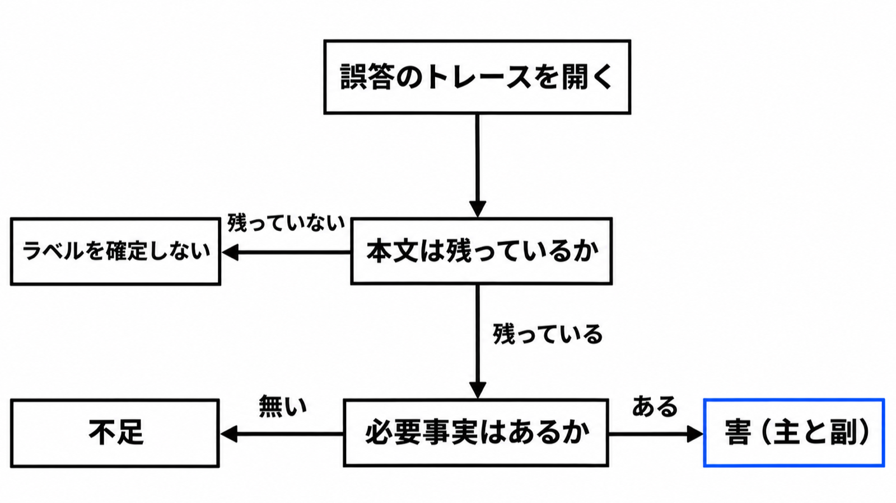

# ダイジェスト: Databricks上の誤答を不足と害で分ける

[元記事](../../../../../articles/databricks-zenn-dev-y0shidahr-p9_20261122.md)

## ひとことで言うと

Databricks上のエージェント誤答は、モデルを替えずに3行で残します。

## 核心ポイント

- 残す3行は、不足、害の名前2つ、本文の有無です。本文（誤りの元の文）が残っていなければ、ラベルを確定しません。
- Poisoningは、モデル自身の以前の出力の誤りを再参照することです。
- Distractionは、コンテキストへの過集中です。
- Confusionは無関係な文書か似たツール、Clashは食い違う文書やツールです。この4つは、必要事実があるときの害の名前です。
- 必要な事実が無い失敗は、4つの名前の外です。見る例は、検索の空、権限、索引の更新漏れです。

## メンタルモデル

上から下へ読みます。左は確定せず、右端の主と副は名前2つです。

## 具体例

無関係な文書が返っても、必要事実が無ければ不足です。必要事実があるとき、古い文と新しい文書の食い違いはClashです。

## 適用と判断

向く場面:

- Databricks上のエージェントが依頼と違う答えを返したときです。
- 同じ質問で、直しの前後を採点で比べるときです。

確認項目:

- 誤りを生んだ本文は、トレースに残っていますか。
- 必要事実は、コンテキストにありますか。
- 害では、同時に当てはまる名前を2つ残していますか。
- 古い索引に必要事実が無いとき、不足にしましたか。

## 限界・注意点

- 名前は重なり、1件が1ラベルとは限りません。2つの名前に順位は付けません。
- 4つの名前は、製品の機能名ではありません。
- 採点機能は、失敗の名前を返しません。

## 参考

- 元記事: [databricks-zenn-dev-y0shidahr-p9_20261122.md](../../../../../articles/databricks-zenn-dev-y0shidahr-p9_20261122.md)
- [Drew Breunig, How Long Contexts Fail（2025-06-22）](https://www.dbreunig.com/2025/06/22/how-contexts-fail-and-how-to-fix-them.html)
- [y0shidahr「Databricksのエージェントがおかしいとき、4つのコンテキストの失敗を見分けて直す」](https://zenn.dev/y0shidahr/articles/2d1fb00790d0ad)
- [Databricks Built-in LLM judges](https://docs.databricks.com/aws/en/mlflow3/genai/eval-monitor/concepts/judges/)
