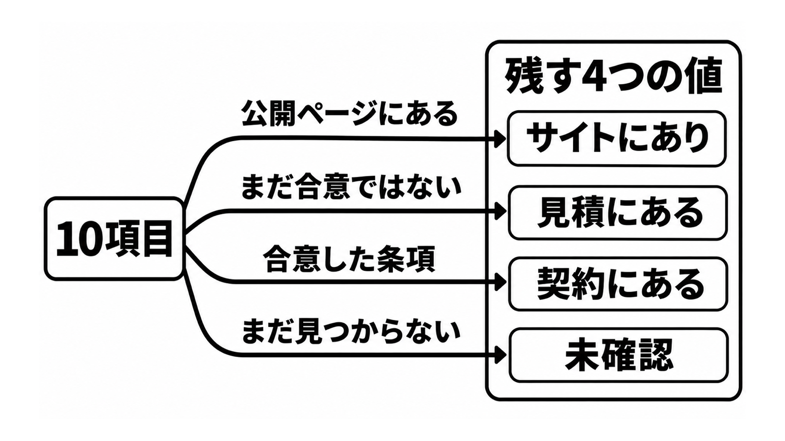

# ダイジェスト: 現場に入る技術者を名乗る40社の公開ページの社数

[元記事](../../../../../articles/fde-itmedia-co-jp-enterprise-p7_20261122.md)

## ひとことで言うと

発注側は、見積の前に10項目の所在を4つの値で残します。

## 核心ポイント

- 対象は、公式サイトで現場に入る技術者（FDE）の語を確認した43社のうち、説明を読めた40社です。
- 数えているのは、選んだ公式ページの文面だけです。
- 作った物の権利か、納めて渡すことは5社、発注側が用意することは7社、最低期間か区切りは14社です。
- 各項目は、サイト、見積か提案、契約、未確認の4つの値で残します。未確認は、やっていないことではありません。

## メンタルモデル

左の箱から、右の4つの値へ矢印が伸びます。

## 具体例

注意例では、置き場の持ち主を発注側へ移したあと、持ち主にしか直せない設定がありました。頼んだ相手は、頼まれても直せませんでした。対象は置き場の管理権限です。

## 適用と判断

向く場面:

- 発注側が、現場に入る技術者を名乗る提案を受ける前です。
- 公開ページの記載と契約書を突き合わせるときです。

確認すること:

- 終わりの基準を、内容と水準まで数字で書きましたか。
- 区切りでやめたとき、手元に残る物を決めましたか。
- 作った物の権利は、IPAの3案のどれに近いかを聞きましたか。
- 支援が止まった後、誰がどの設定を直せるかを決めましたか。
- 見積にある項目を、契約の条項と分けて残しましたか。

## 限界・注意点

- 公開ページに無いことは、契約に無いことの証明にはなりません。
- この社数は、利用規約・見積・契約書だけにある権利や期間を含めていません。
- 月額20万円から60万円は、月額で読めた8社の最も低いプランです。相場でも、実際の取引金額でもありません。
- 社名と読んだページの対応は、参考のゴムマリの本文にはありません。
- 契約書に権利や期間が何社分あるかは、この調査は測っていません。

## 参考

- [元記事](../../../../../articles/fde-itmedia-co-jp-enterprise-p7_20261122.md)
- [ITmedia エンタープライズ「『名ばかりFDE』を見抜けるか？」（2026-11-20）](https://www.itmedia.co.jp/enterprise/articles/2611/20/news028.html)
- [ゴムマリ「FDEを名乗る国内40社の公式サイトを調査」](https://gomumari.com/knowledge/fde-tanomu-mae-2026/)
- [IPA「情報システム・モデル取引・契約書（第二版）」](https://www.ipa.go.jp/digital/model/model20201222.html)
- [経済産業省「AIの利用・開発に関する契約チェックリスト」（2025-02-18）](https://www.meti.go.jp/policy/mono_info_service/connected_industries/sharing_and_utilization/20250218003-ar.pdf)
