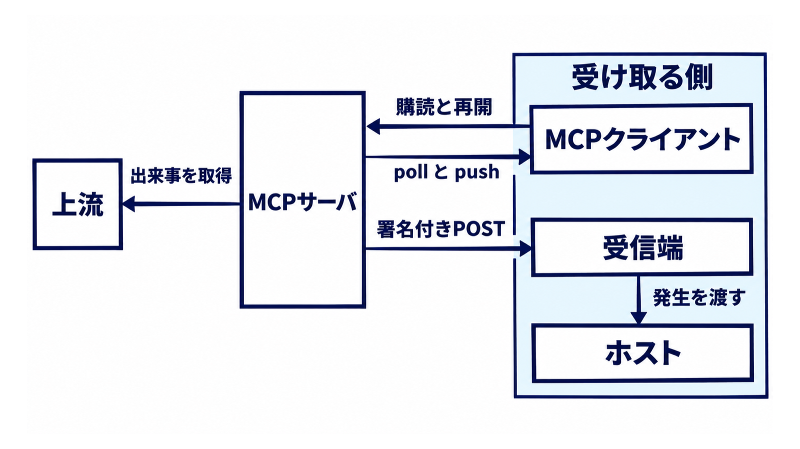

# ダイジェスト: 外部イベントでエージェントを起こす MCP Events

[元記事](../../../../../articles/mcp-events-beta-mcp-io-events-p1_20261122.md)

## ひとことで言うと

MCP（問いと応答の手順）の作業部会は、上流の出来事でエージェントを起こす拡張を Beta で公開しました。

## 核心ポイント

- イベント型は、購読引数と配送データと配送モードを名前ごとに持ちます。
- クライアントは、型が掲げるモードのうち、実行できる1つを選びます。
- カーソルは、クライアントが再開に使う不透明な位置です。
- 購読台帳の正本はクライアントです。
- 届いた中身は信頼しない入力です。

## メンタルモデル

中央のサーバが左の上流から出来事を取り、右の枠が受け取る側です。poll と push はクライアントへ、webhook は受信端から、ターンを始めるホストへ渡ります。

## 具体例

メール到着を poll し、一覧が空ならホストはターンを始めません。

## 適用と判断

向く場面:

- 購読者ごとの状態を持たないサーバでは poll を使います。
- つなぎっぱなしのクライアントでは push を使います。
- クライアントが長寿命接続を持てない遠隔では webhook を使います。

確認項目:

- 対象は beta 仕様に合わせますか。
- カーソルを購読ごとに耐久保存しますか。
- 載っていない中身を取る呼び出しは、発生とは別に認可しますか。
- webhook の秘密はクライアントが作りますか。
- 欠落が問題なら、上流の状態を読み直しますか。

## 限界・注意点

- 正確に1回の配送は保証しません。
- 公式 SDK と適合試験は、2026-11-22 時点で未マージです。
- 再送できない型では、欠落した出来事は戻りません。
- ChatGPT の対応は webhook だけで、poll と push は対象外です。
- 3モード対応とされた唯一のクライアントが、beta どおりかは未確認です。

## 参考

- 元記事: [mcp-events-beta-mcp-io-events-p1_20261122.md](../../../../../articles/mcp-events-beta-mcp-io-events-p1_20261122.md)
- [beta 仕様 events.mdx](https://github.com/modelcontextprotocol/ext-events/blob/main/specification/beta/events/events.mdx)
- [SEP-3415 Events Extension](https://modelcontextprotocol.io/seps/3415-events-extension.md)
- [クライアントの対応表](https://modelcontextprotocol.io/extensions/client-matrix)
- [ChatGPT MCP Events](https://developers.openai.com/plugins/build/mcp-events)
