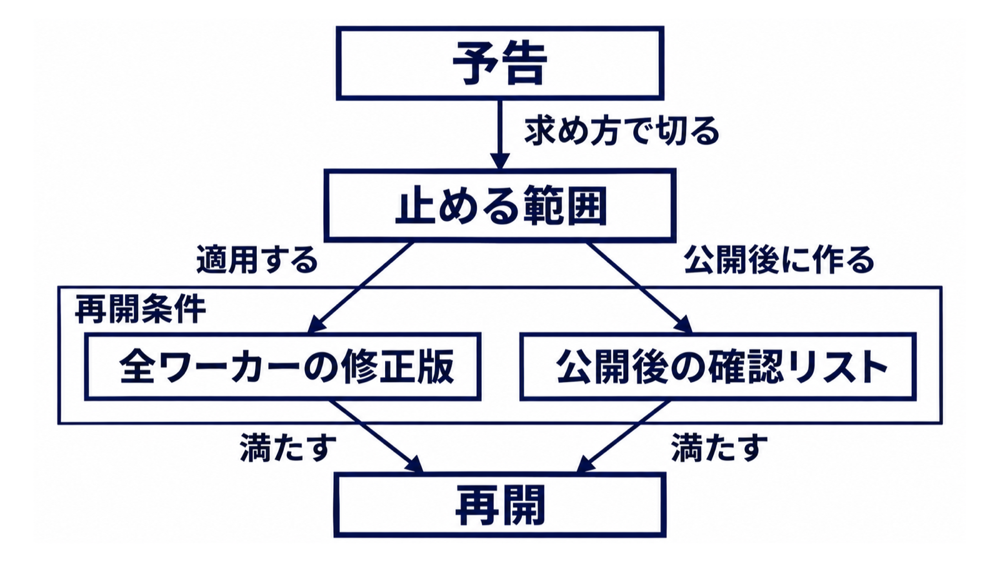

# ダイジェスト: PHPの緊急修正で、止める範囲と再開条件を決める

[元記事](../../../../../articles/php-itmedia-co-jp-2611-p3_20261122.md)

## ひとことで言うと

11月の PHP 修正は、求め方で止める範囲を切り、再開は修正版と欠陥ごとの確認の両方です。

## 核心ポイント

- 11月18日の予告（公開前の知らせ）が求めるのは、公開後の速やかな更新です。
- 10月21日の別の修正は、更新だけが安全な選択です。この求め方のときは、公開前に外向きの受付を止めます。
- 入れ替えたパッケージだけでは、再起動前の処理は古い実行ファイルのままです。
- 再開は、全ワーカー（処理プロセス）の修正版と、公開後の確認リスト（欠陥ごとの確認）の両方です。
- 既定でない設定か一般的でない構成を要する知らせが、速やかな更新を求めるときです。そのとき修正が出る版で、接続の使い回しが無く回避が動いている処理に入れば、直後の修正版への再起動で全面停止を省けます。

## メンタルモデル

上から、予告、止める範囲、再開の条件、再開の順に読みます。止める範囲から修正版への矢印は、修正をその処理へ入れることです。

## 具体例

財務省は、一部の機能だけを修正の公開前から止めました。再開時期は、知らせの時点で未定でした。

## 適用と判断

向く場面:

- 公開前の知らせから、止める範囲を切るときです。
- 修正版のあと、再開してよいかを判定するときです。
- 修正が無い版で、止め続けるかサービスを終えるかを決めるときです。

確認すること:

- 知らせは、更新だけが安全ですか。
- 全ワーカーが修正版を読んでいますか。
- 公開後の説明で、欠陥ごとに届くかを確かめましたか。
- PHP への接続の使い回しは止まっていますか。

## 限界・注意点

- 1件の回避は、その1件だけを塞ぎます。
- 本番用の設定例だけでは、全面停止を省く条件を満たしません。
- 届く範囲が予告より広がった件は、公開後の説明で再開を判定します。
- 普段の設定でも、別の条件が揃うと届く欠陥があります。
- PHP 8.6 がこの修正を含むかは、知らせから分かりません。止めている間は再開を保留します。

## 参考

- 元記事: [php-itmedia-co-jp-2611-p3_20261122.md](../../../../../articles/php-itmedia-co-jp-2611-p3_20261122.md)
- [The PHP Group: News Archive - 2026](https://www.php.net/archive/2026.php)
- [php/php-src security advisories](https://github.com/php/php-src/security/advisories)
- [財務省: 一部機能停止](https://www.mof.go.jp/public_relations/ohter/2026111901.html)
- [The PHP Group: Supported Versions](https://www.php.net/supported-versions.php)
