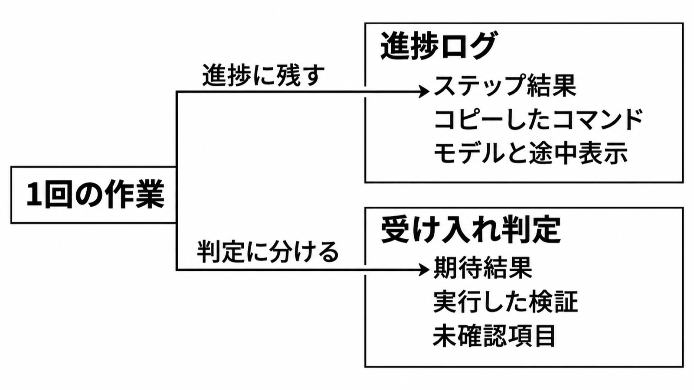

# ダイジェスト: Copilot Chatの進捗と受け入れ判定

[元記事](../../../../../articles/zenn-dev-heftykoo-cf9c142df8f81-p5_20261122.md)

## ひとことで言うと

Copilot Chat の進捗表示は、人が書く受け入れ判定とは別の欄に残します。

## 核心ポイント

- コピーしたコマンドは、人がもう一度実行するための文字列です。
- ベンチマークの採点は、失敗していたテストが通り、既に通っていたテストを壊さないことです。
- Autopilot は、エージェントが完了とみなすまで続けます。
- 完了とみなして止めたことは、上の採点と同じ意味ではありません。
- 完了まで続ける設定と実行前の確認を同時に選ぶと、自動承認の無いツールは確認を待たずに拒否されます。

## メンタルモデル

上の枠が進捗ログ、下の枠が受け入れ判定です。作業から、それぞれの枠の先頭へ矢印が向きます。

## 具体例

チャット画面の説明文にある 19 件の作業は、ベンチマークの 157 件とは別です。

## 適用と判断

向く場面:

- Copilot Chat の作業を人のレビューに渡すときです。
- 画面の完了表示で合否を決める前です。

確認項目:

- 判定欄に期待結果を書きましたか。
- 実行した検証を書きましたか。
- 失敗か拒否のとき、未確認の項目を残しましたか。
- 進捗の記録を残していますか。
- 完了の一文を判定の理由にしていませんか。

## 限界・注意点

- ステップ結果が生の出力か、要約か、終了コードを含むかは、公開ページから決まっていません。
- コマンド文字列が作業ディレクトリを含むかは、公開ページにありません。
- エージェントが完了とみなす内部の条件は、公開ページにありません。
- ベンチマークの数値は、Microsoft の自己申告です。この記事は、その数値を測り直していません。
- 公式の定義が 18.12 のチャットに付くまで、完了文面は判定にしません。ステップ結果を終了コードとテスト出力の保存とするか、完了文面が期待結果とコマンドを構造化して引用することです。

## 参考

- 元記事: [zenn-dev-heftykoo-cf9c142df8f81-p5_20261122.md](../../../../../articles/zenn-dev-heftykoo-cf9c142df8f81-p5_20261122.md)
- [Visual Studio Blog（2026-11-10）](https://devblogs.microsoft.com/visualstudio/copilot-in-visual-studio-just-got-a-major-upgrade/)
- [Learn の Copilot Chat](https://learn.microsoft.com/en-us/visualstudio/ide/visual-studio-github-copilot-chat?view=visualstudio)
- [Visual Studio 2026 リリースノート](https://learn.microsoft.com/en-us/visualstudio/releases/2026/release-notes)
- [GitHub Docs「Manage agent sessions」](https://docs.github.com/en/copilot/how-tos/copilot-on-github/use-copilot-agents/manage-and-track-agents)
