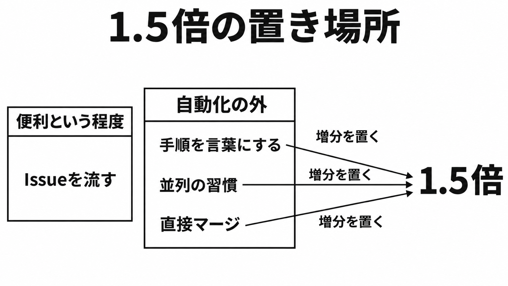

# ダイジェスト: 1.5倍はIssueを流す流れの外に置く

[元記事](../../../../../articles/1-5-zenn-dev-z-maruhira-factory-p7_20261123.md)

## ひとことで言うと

1人がスプリントごとにこなせる点数は1.5倍、という自己申告です。丸平氏は増分を、Issueを流す流れの外に置きます。

## 核心ポイント

- 丸平氏の自作は、Issueを10分ごとに拾います。これを、設計と実装のプルリクエストまで流します。
- 人は設計を見ます。実装は、想定外のコードと、手動でしか確かめられない動作だけ見ます。
- 流れを動かした人以外のプルリクエストを、権限のある人がマージできます。
- 丸平氏は1.5倍を、手順を言葉にしたこと、待ちのあいだの別作業、権限者のマージに置きます。言葉にした手順は、自分で動かすときにも効きます。
- 丸平氏は、Issueを流す機能が製品になっても、Issueの書き方、受け入れの条件、誰がどこを見るかは残ると予想します。

## メンタルモデル

「自動化の外」は左のIssueを流す流れの外で、「並列の習慣」は待ちのあいだの別作業です。「直接マージ」は、権限のある人がマージすることです。

## 具体例

変更の自動検査が通っていれば、人はテストを見ません。

## 適用と判断

向く場面:

- 自作の開発の流れを続けるか決めるときです。
- 1.5倍を、他のチームの目標に写すか決めるときです。
- Issueを流す機能が製品になったあと、残すものを選ぶときです。

確認項目:

- Issueを流せるかだけで、採用を決めていますか。

## 限界・注意点

- 3か月の自己申告は、納期前の残業で2倍近くを1.5倍に割り引いたものです。割引の式は未確認です。
- 完了した仕事が増えていなくても、点数は見積の切り方で増え得ます。
- 流れを直す時間は、点数の外です。1.5倍はその時間を使った期間の倍率です。
- 実行は手元の機械なので、夜と休日は止まります。クラウドとの違いは未確認です。
- 1.5倍は、他のチームの目標には写しません。スプリントの長さ、基準の点数、短くなった時間の長さ、マージ後の欠陥は未確認です。

## 参考

- 元記事: [1-5-zenn-dev-z-maruhira-factory-p7_20261123.md](../../../../../articles/1-5-zenn-dev-z-maruhira-factory-p7_20261123.md)
- [丸平「ソフトウェアファクトリーは不要なのか？」](https://zenn.dev/z_maruhira/articles/software-factory-needed)
