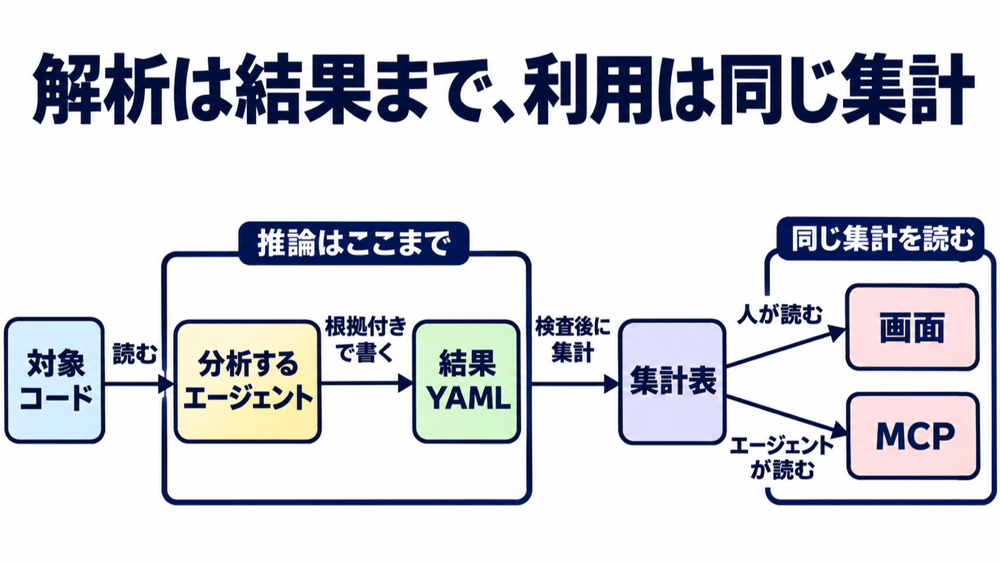

# ダイジェスト: コード解析を根拠付きデータとして残す

[元記事](../../../../../articles/as-built-atlas_20261123.md)

## ひとことで言うと

as-built-atlas は、AIのコード解析を根拠付きデータとして残し、人とエージェントが読む OSS です。

## 核心ポイント

- 推論は、入口（ジョブ・画面・APIなど）1 件の結果を書くまでです。
- 集計は、同じ結果から同じ集計表を作ります。
- 事実と解釈には、ファイルと行の根拠が要ります。
- 画面と、エージェントが読む口は、同じ集計表を読みます。
- 不明は、決まった理由の語で残します。

## メンタルモデル

図の MCP は、エージェントが集計表を読む口です。

## 具体例

架空の見本、ことり書店では、売上確定と、それを呼ぶ入口が shop.orders を更新します。更新の実体は settle_orders.py の 39 行だけです。エージェントは集計表だけで、この 2 件と根拠行を答えました。

## 適用と判断

向く場面:

- どの処理がどのデータを書くか、入口をまたいで見たいときです。
- 根拠の行から、対象のソースを開きたいときです。
- コード探索の前に、集計表をエージェントへ渡したいときです。

確認すること:

- 対象技術のプロファイル（層・入口・分類）はありますか。
- 分析する入口を、人が先に承認しますか。
- 集計のあと、根拠のファイルと行へ戻りますか。
- 影響を見て、再分析か残すかを記録しますか。

## 限界・注意点

- 検査を通っても、解釈が対象の挙動と一致するとは限りません。
- 根拠の行があっても、結果の説明はソースの条件とずれることがあります。
- 同梱の見本に費用の記録は無いので、対象の規模に合わせて少数の入口を試して見積もります。
- コードが変わると結果は古くなります。
- ことり書店の適合率と再現率は、リポジトリに公開されていません。

## 参考

- 元記事: [as-built-atlas_20261123.md](../../../../../articles/as-built-atlas_20261123.md)
- [as-built-atlas（GitHub）](https://github.com/suwa-sh/as-built-atlas)
- [README 日本語（v0.6.0）](https://github.com/suwa-sh/as-built-atlas/blob/v0.6.0/README.ja.md)
- [紹介ページ](https://suwa-sh.github.io/as-built-atlas/?lang=ja#start)
- [分析結果の形式](https://github.com/suwa-sh/as-built-atlas/blob/v0.6.0/docs/architecture/formats.md)
