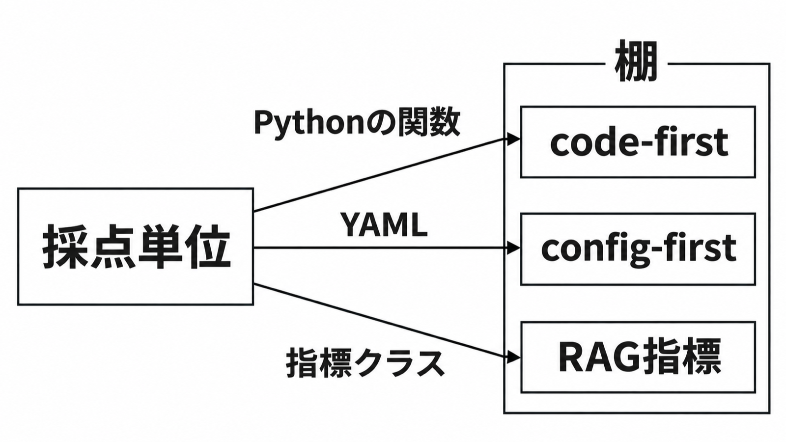

元記事: [eval-framework-selection_20261123](../../../../../articles/eval-framework-selection_20261123.md)

## ひとことで言うと

評価の仕組みは、採点する対象と実行の形で選びます。

## 核心ポイント

- 先に、最終回答、呼んだ道具、検索順位、資料に沿うかのどれを採点するか決めます。
- Python の関数で書くのは、Inspect、DeepEval、Pydantic Evals です。
- YAML で書くのは、Promptfoo と lm-evaluation-harness です。
- RAG指標は、検索と回答の関係を見る Ragas です。
- 採点に使うモデルは、採点されるモデルと分けて指定します。

## メンタルモデル

左の採点単位から、右の棚へ矢印が伸びます。指標クラスと書かれた矢印は、RAG指標の実行の形です。

## 具体例

期待値は Paris、出力は Not Paris です。Inspect の末尾一致と Promptfoo の包含は通ります。Pydantic Evals の全体の等値は落ちます。

## 適用と判断

向く場面:

- 採点する単位が未決のときです。
- 検索順位と、回答が資料に沿うかを分けたいときです。
- CI の失敗を終了コードに合わせるときです。

確認項目:

- 定義を、Python の関数か YAML に決めましたか。
- 終了コードの意味を製品ごとに見ていますか。

## 限界・注意点

- クラス名、必須項目、CLI の形は、公式文書のあいだで食い違います。
- Promptfoo の終了コード 100 は、採点される側の停止も含みます。
- inspect eval は、失敗ログでもプロセスを成功で終えます。
- 正解が無く実際の回答がある適合率は、ContextUtilization です。

## 参考

- [元記事](../../../../../articles/eval-framework-selection_20261123.md)
- [How to pick an eval framework that checks what you ship](https://x.com/sermakarevich/status/2124210425331921148)
- [Inspect](https://inspect.aisi.org.uk/)
- [Promptfoo のコマンドライン](https://www.promptfoo.dev/docs/usage/command-line/)
- [Ragas の quickstart](https://docs.ragas.io/en/stable/getstarted/quickstart/)
