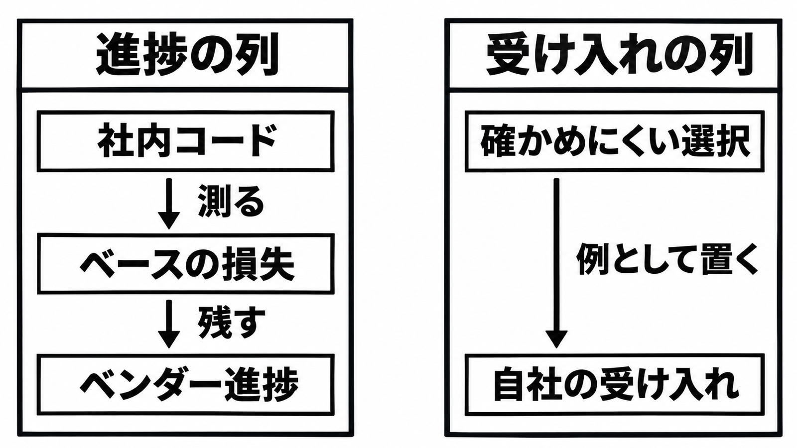

# ダイジェスト: OpenAIが社内コードの損失を共有指標にした

[元記事](../../../../../articles/openai-perplexity-openai-p9_20261123.md)

## ひとことで言うと

OpenAIは、社内コードで次のトークンを予測した損失を、進捗を話す指標として公開しました。

## 核心ポイント

- 名前はlog-perplexityで、低いほど次のトークンの予測が良いです。
- 測るのは、事前学習を終えたモデルが、学習に使っていない社内コードで出した値です。
- 本文の約の数、元記事の図の測定値、その注記は、別々に残します。
- この損失の0.68から0.70は、さらなる能力を期待する区間です。合意した停止線としては書かれていません。
- モデル更新の採否では、ベンダーの進捗欄と自社の受け入れ欄を分けます。

## メンタルモデル

左の「ベースの損失」は、事前学習を終えた時点の損失です。右の矢印は、上の選択を受け入れの例として置く、と読みます。

## 具体例

本文の約0.99は、元記事の図の0.986に対応します。

## 適用と判断

向く場面:

- モデル更新の採用で、ベンダーの損失を見るときです。
- この損失を、他社の損失と並べるときです。
- この損失の0.68から0.70を、停止線と読む前です。

確認項目:

- 測ったデータを、進捗欄に残しましたか。
- 事前学習を終えた時点の値かを、進捗欄に残しましたか。
- 根拠が出力に含まれるかを、受け入れ欄で見ましたか。
- 失敗したときに止まれるかを、受け入れ欄で見ましたか。
- 明確で速いフィードバックが無い選択での振る舞いを、受け入れ欄で見ましたか。

## 限界・注意点

- 文章を区切る単位が違う他社の損失は、同じ尺度ではありません。
- 元記事の図では、次の世代で損失が上がる点があります。
- 答える前に考えを書かせる使い方は、能力が上がってもこの損失を下げません。
- 図の「数学の問題を解いた」がどの問題かは、未照合です。

## 参考

- 元記事: [openai-perplexity-openai-p9_20261123.md](../../../../../articles/openai-perplexity-openai-p9_20261123.md)
- [Jakub Pachocki, Perplexity and Intelligence, OpenAI, 2026-11-22](https://openai.com/index/perplexity-and-intelligence)
- [OpenAI, chain-of-thought monitorability, 2026-11-10](https://openai.com/safety-alignment/cot-monitorability-model-lifecycle/)
- [METR, AI R&D-relevant model capabilities, 2026-11-20](https://metr.org/blog/2026-11-20-q4-2026-capability-update/)
- [Sabrina J. Mielke, Can you compare perplexity across different segmentations?, 2019-04-23](https://sjmielke.com/comparing-perplexities.htm)
