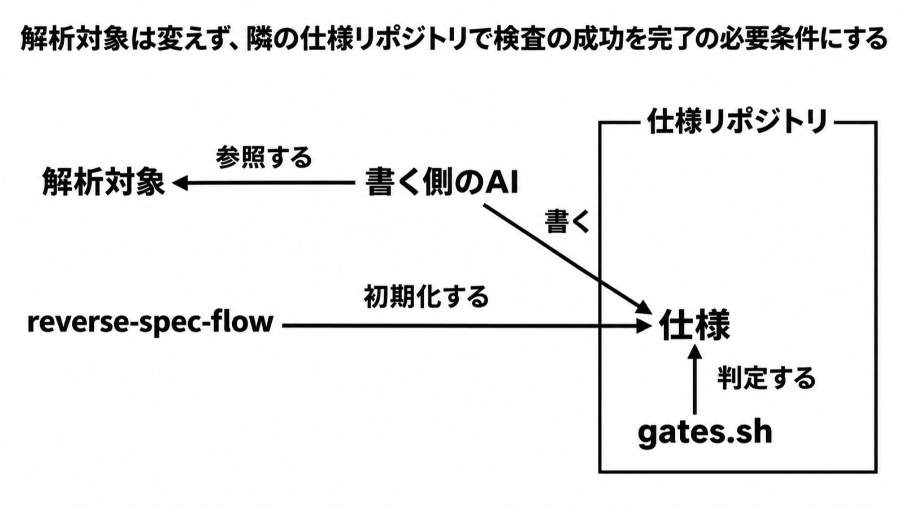

# ダイジェスト: 既存コードから検査付きの仕様を起こす

[元記事](../../../../../articles/reverse-spec-flow_20261123.md)

## ひとことで言うと

AWS の reverse-spec-flow は、既存ソースから検査付きの仕様を作ります。

## 核心ポイント

- 成果物は、解析対象の隣にある独立した git リポジトリです。
- 解析対象は参照専用です。
- 完了の必要条件は、gates.sh（完了の検査）の成功です。
- 見積りと再構築では、今の実装の事実と本質層（技術に依存しない層）に分かれます。
- コードグラフ（モジュール、入口、境界の一覧）に未着手か分析中が残ると、完了にしません。

## メンタルモデル

左上の解析対象を、中央の書く側のAIが参照します。左下の reverse-spec-flow が右の仕様を初期化し、枠内の gates.sh が仕様を判定します。

## 具体例

| 目的 | 完了に要ること |
|---|---|
| 保守（maintenance） | 指定した節が空でない |
| 見積り（evaluation） | 保守に加え、本質層が1件以上あり、一覧の項目がどれも本質層へ対応づく |
| 再構築（rebuild） | 保守に加え、各部分を書き手と別に確かめ、根拠の無い記述は残さず、部分の外は別に確認する |

## 適用と判断

向く場面:

- 仕様が無いか、古くなった仕様を保守するときです。
- 再構築の見積りで、本質層の概要まで欲しいときです。
- 仕様を入力に、作り直すときです。

確認項目:

- 目的を、保守、見積り、再構築から選びましたか。
- 解析対象は、reverse-spec-flow と別のディレクトリにありますか。
- 作業は、生成先のリポジトリで開いていますか。
- 書く側は Claude Code、Kiro IDE、Kiro CLI ですか。
- 仕様リポジトリを、公開リモートへ送っていませんか。

## 限界・注意点

- 起動や画面操作、データベースへの問い合わせは、やらなくても進められます。
- 範囲を縮めるときや工程の境界では、人の確認を挟みます。
- 監査を終えた宣言と、再構築できる宣言には、独立検証と人の確認が要ります。
- 動的な振る舞いは、仕様だけでは確定できません。
- v2.2.0 以降、再構築の検査時間は公開資料にありません。

## 参考

- 元記事: [reverse-spec-flow_20261123.md](../../../../../articles/reverse-spec-flow_20261123.md)
- [reverse-spec-flow README](https://github.com/aws-samples/sample-reverse-spec-flow/blob/main/README.md)
- [AWS ブログ Reverse Spec Flow の紹介（2026-11-21）](https://aws.amazon.com/jp/blogs/news/aidm-introducing-reverse-spec-flow/)
- [利用者向けの仕組み](https://github.com/aws-samples/sample-reverse-spec-flow/blob/main/docs/how-it-works.md)
- [ホストアダプタ](https://github.com/aws-samples/sample-reverse-spec-flow/blob/main/hosts/README.md)
