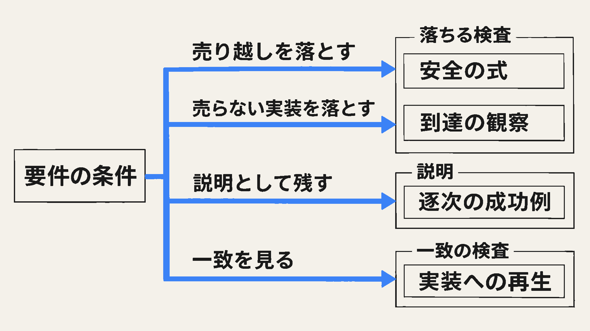

# AIの生成テストの前に置く、Quintの不変条件

元記事: [AIの生成テストの前に置く、Quintの不変条件](../../../../../articles/tla-zenn-dev-karamage-73027-p5_20261123.md)

## ひとことで言うと

karamage氏は、生成テスト（AIが書くテスト）の前に、破ってはいけない条件の式を置きます。

## 核心ポイント

- Quint（実行できる仕様言語）で式を検査し、操作列を実装で実行して仕様との一致を見ます。
- チケット例の式は1本で、販売数が初期在庫を超えないことです。
- その式は、販売数3・在庫-1の売り越しを落とします。
- 販売数と在庫の和の式は、在庫を減らして販売数を増やす売り越しを通します。
- 利用者3人・在庫2枚の世界を、ランダム実行とTLC（到達状態を尽くす検査）が見ます。

## メンタルモデル

矢印は左の要件の条件から、右の4つの置き場へ向かいます。右の枠は、落ちる検査、説明、一致の検査です。

## 具体例

| 仕様 | 購入の更新 |
| --- | --- |
| バグ | 在庫を確認したあとなら、在庫を見ずに在庫を1減らし販売数を1増やす |
| 修正 | 在庫が残るときだけ同じ更新をし、無ければ枚数を変えず売切にする |

## 適用と判断

向く場面:

- 複数の利用者の操作順が、結果を変えるときです。
- 生成テストの採点元を、条件の式へ戻すときです。
- 操作が混ざる順の代わりに並んだ成功例を、式へ移すときです。

確認すること:

- 売らない実装を、初期在庫まで売れたかで落とせますか。
- 採点に使う式の文面を、人が読みましたか。
- 操作順が結果を変える箇所だけを、状態を尽くす検査にしますか。
- 仕様を、実装の変更に追随させますか。

## 限界・注意点

- 1枚も売らない実装は、販売数が初期在庫を超えない式を満たします。
- ランダム実行の成功は、試した実行に違反が無かったことまでです。
- 実装への再生は、コードが正しいことの証明にはなりません。
- 検査器を指定しない検証は、記事が使ったTLCとは別です。

## 参考

- 元記事: [AIの生成テストの前に置く、Quintの不変条件](../../../../../articles/tla-zenn-dev-karamage-73027-p5_20261123.md)
- karamage「[AIにテストケースを書かせるな。ルールを書け](https://zenn.dev/karamage/articles/73027ee36796dc)」
- Quint docs「[Checking Properties](https://quint.sh/docs/checking-properties)」
- Quint docs「[Understanding the Simulator](https://quint.sh/docs/simulator)」
- Quint docs「[Model-based Testing](https://quint.sh/docs/model-based-testing)」
