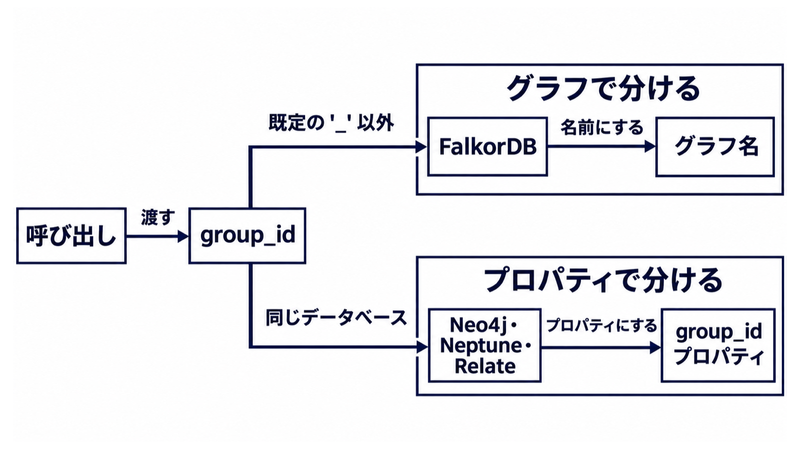

# ダイジェスト: Graphiti 0.32の分離は group_id

[元記事](../../../../../articles/graphiti-0-32-github-getzep-p9_20261124.md)

## ひとことで言うと

Graphiti 0.32 は、エージェントの記憶を知識グラフにする枠組みです。

## 核心ポイント

- 知識グラフの分離の単位は、呼び出しが渡す group_id（分離キー）です。
- FalkorDB では、'_' 以外だけが別のグラフ名になります。
- Neo4j、Neptune、Relate では、同じデータベースのプロパティです。
- 同梱の見本サーバの既定 main は、ライブラリの空文字とも FalkorDB の '_' とも違います。
- 並行取り込みは、同時実行の指定を渡したときだけ有効です。

## メンタルモデル

図は左から読みます。FalkorDB への矢印は、既定の '_' 以外のときです。

## 具体例

support-team は、英数字とハイフンだけなので呼び出し側の group_id として通ります。

## 適用と判断

向く場面:

- テナントの境界を group_id で切るときです。
- 1 つの group_id へ複数の取り込みを同時に出すときです。
- 0.32 へ上げる前に、Kuzu（旧保存先）が残っていないか見るときです。

確認すること:

- 使っている既定の文字列を確認しましたか。
- 分離の実体をグラフ名かプロパティか決めましたか。
- 検索と削除に意図した group_id を渡しますか。
- 並行取り込み中、コミュニティ（実体の組）の更新はオフですか。
- 保存先は、公式が並行可と書く Neo4j か FalkorDB ですか。

## 限界・注意点

- 同梱の見本サーバは、呼び出し元を認可しません。
- バックアップは、グループを選ばず、ボリュームかファイルの単位で取ります。
- Neo4j で削除と追加が重なり新しい事実が消える報告は、このタグでは未確認です。
- Neo4j の複数 group 全文検索が、最後の group だけを必須にする点は、このタグでは未確認です。
- 起点が Entity のとき、Neptune の起点探索が別 group へ辿り得る点は、このタグでは未確認です。

## 参考

- 元記事: [Graphiti 0.32のグループ分離と並行取り込み](../../../../../articles/graphiti-0-32-github-getzep-p9_20261124.md)
- [タグ v0.32.0](https://github.com/getzep/graphiti/releases/tag/v0.32.0)
- [並行取り込み](https://help.getzep.com/graphiti/core-concepts/concurrent-ingestion)
- [Kuzu ドライバの削除](https://github.com/getzep/graphiti/pull/2151)
- [1 グラフの並行取り込み](https://github.com/getzep/graphiti/pull/2154)
