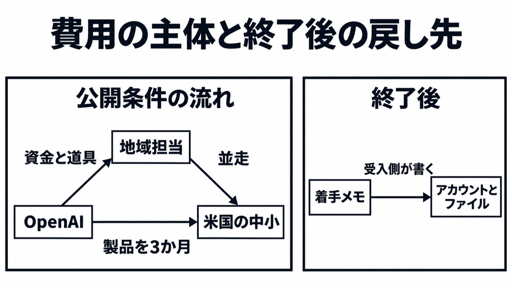

# ダイジェスト: OpenWorksの費用と終了後の所在

[元記事](../../../../../articles/openai-ai-openworks-openai-p6_20261124.md)

## ひとことで言うと

OpenWorksはOpenAIが地域の担当者へ資金を出す支援です。
アカウントとファイルの所在は公開条件で決まりません。

## 核心ポイント

- OpenAIが資金と道具を地域の担当者へ渡します。
- 事業者の参加は無料です。
- 事業者は、ChatGPT Business（有料の席）を3か月無償で受け取ります。
- 事例の数値は、見積と発言です。
- 現場支援は、費用の支払者と、終了時のアカウントとファイルの所在で分けます。

## メンタルモデル

左の「並走」は、担当者が事業者の作業に一緒に入る矢印です。
右の「着手メモ」は、受入側がアカウントとファイルについて書く欄です。

## 具体例

OpenAIの2026年9月の別提携は、既存の支援機関の人を訓練する型です。
その提携では、訓練する相手の給与主体は書かれていません。
事業者が費用を払う顧問は、終了時の戻し方を契約に書けます。

## 適用と判断

向く場面:

- 独立所有の米国中小が、この支援を受ける前です。
- 費用の出し方で、現場の支援を比べる前です。
- 無償期間のあと席を続けるか決める前です。

確認項目:

- 秘密保持の相手を書きましたか。
- 在庫や会計の認証情報を渡さないと書きましたか。
- 成果ファイルを店のツールに置きますか。
- 3か月後に席を続けるか止めるかを決めましたか。
- 事業者が契約上の顧客ですか。

## 限界・注意点

- 地域の担当者への資金は月8,000ドルが上限です。雇用、業務委託、助成のどれかと、支払月数は書かれていません。
- 入力と出力は、事業者が契約上の顧客であるとき、その事業者のものです。
- 日本の事業者への申込案内は、今回の公開条件にはありません。
- アカウントの所有者と席数は、公開面で決まっていません。
- OpenWorksと同じ名前の清掃会社の条項は、この支援には使えません。

## 参考

- 元記事: [openai-ai-openworks-openai-p6_20261124.md](../../../../../articles/openai-ai-openworks-openai-p6_20261124.md)
- [OpenWorks](https://openai.com/openworks/)
- [OpenAI Services Agreement](https://openai.com/policies/services-agreement/)
- [ChatGPT 料金](https://openai.com/business/chatgpt-pricing/)
- [2026年9月の別提携](https://openai.com/index/helping-small-businesses-put-ai-to-work/)
