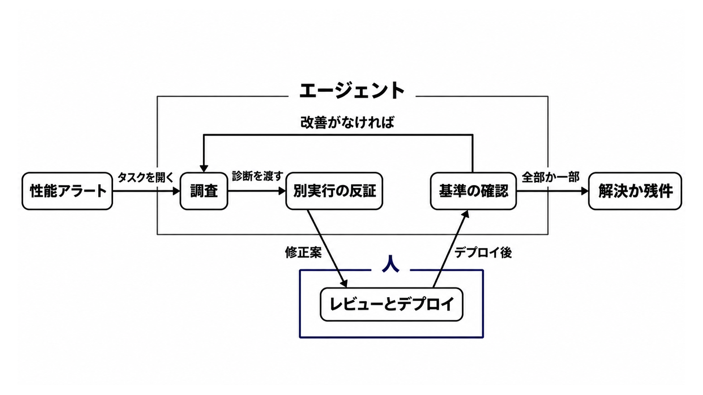

# ダイジェスト: OpenAIのPerformance Factoryは出荷判断を人に残す

[元記事](../../../../../articles/openai-performance-factory-p2_20261124.md)

## ひとことで言うと

OpenAIの社内の仕組みは、性能の調査と確認をエージェントに渡し、出荷の判断は人に残します。

## 核心ポイント

- 検出は性能アラート、調査と修正案と基準の確認はエージェント、レビューとデプロイは人です。
- 診断と修正案は、作った実行とは別の実行が誤りを探してから人に渡します。
- デプロイ後は以前の基準と比べます。戻れば解決、一部なら元のタスクを閉じて残りを新タスク、改善が無ければ調査へ戻します。
- 3か月余りで調査は1,700件を超えました。これは処理した量です。
- 同じ型の土台は、メトリクス、トレース、プロファイルと、アラートからタスクを起こす遷移です。

## メンタルモデル

「別実行の反証」は、調査と人のレビューの間にある箱です。戻る矢印は、改善が無かったときの再調査です。

## 具体例

元記事の例では、社内ワーカーの起動時間の中央値が20.6秒から45〜50秒になりました。翌日の切り戻しで基準に戻りました。予防の修正は草案のままです。

## 適用と判断

向く場面:

- アラートのあと、別の担当が調査を再開するときです。
- 修正案を、人のレビューなしでマージする前です。
- 調査件数を、待ち時間の成果と読む前です。

確認項目:

- 悪化の開始時点を、タスクに残しましたか。
- 同種が遅くなったのか、もともと遅い割合の増加かを分けましたか。
- 修正案を、別の実行が見ましたか。
- 速度以外の副作用を、受け入れ前に書きましたか。
- 改善が無ければ、そのタスクを閉じていませんか。

## 限界・注意点

- 70%は、原因候補100件を自社が正確と採点した割合です。
- 低リスクな変更の無人出荷は、今後の検討です。
- キャッシュは速くなりえて、古いデータを返しえます。
- 利用者から見た待ち時間の前後差は、公開されていません。

## 参考

- 元記事: [openai-performance-factory-p2_20261124.md](../../../../../articles/openai-performance-factory-p2_20261124.md)
- [Okay Zed, Cyrus Forbes, How OpenAI’s Performance Factory keeps ChatGPT fast, 2026-11-19](https://openai.com/index/how-openai-performance-factory-keeps-chatgpt-fast/)
- [同記事の日本語版, 2026-11-19](https://openai.com/ja-JP/index/how-openai-performance-factory-keeps-chatgpt-fast/)
- [埋め込みタスクレポートの画像（REG-482）](https://images.ctfassets.net/kftzwdyauwt9/5w8KpwlFR3tNfJbAStImkG/ee5f1df65a302cb09dde0a7d52d09138/performance-factory-worker-startup-report.png)
