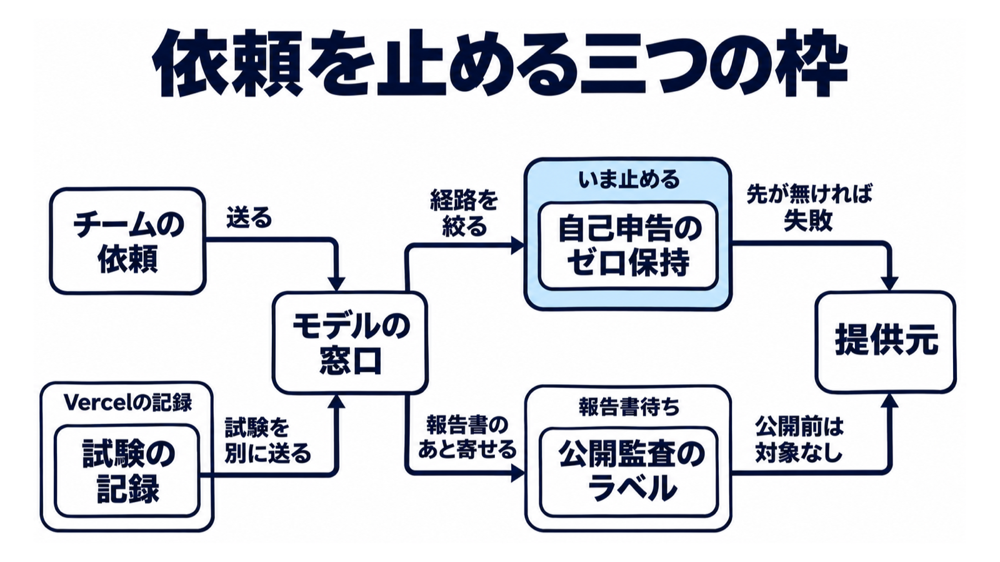

# Vercel AI GatewayのAudited ZDRとカナリア監査の読み方

元記事: [Vercel AI GatewayのAudited ZDRとカナリア監査の読み方](../../../../../articles/vercel-ai-gateway-vercel-p1_20261124.md)

## ひとことで言うと

VercelのAudited ZDRは、独立したセキュリティ企業の報告書が出た提供元に付くラベルです。

## 核心ポイント

- 提供元は、依頼の行き先の会社です。2026年11月24日時点では、提供元のBaseten、Modal、Waferの報告書は出ていません。
- 対象に入るのは、独立したセキュリティ企業が残さない主張を調べ、報告書を公開したときだけです。
- カナリア（他に無いURLの試験）が見るのは、Vercelが送る依頼に埋めたURLです。アクセスは提供元とモデルと実行つきで記録します。
- 自己申告のゼロ保持（応答後に本文を残さない）をオンにした依頼は、その先へ寄せます。その先が無ければ、依頼は失敗します。
- 学習の禁止は、ゼロ保持とは別の設定です。片方をオンにしても、もう片方はオンになりません。

## メンタルモデル

上は経路を絞る矢印、下は報告書のあと寄せる矢印です。試験は窓口へ別に送る矢印です。

## 具体例

ゼロ保持をオンにしたあとの扱いです。

| ケース | 扱い |
| --- | --- |
| 提供元がウェブ検索し、結果を回答へ足すとき | 依頼は続きます。別のサービスが残しえます。 |
| 同じ入力を再利用する保存 | 依頼は続きます。提供元が表現を持つ期間は最大24時間になりえ、窓口は保持に数えません。 |
| 一括の依頼 | 投入の時点で拒否します。 |

## 適用と判断

向く場面:

- Pro、Enterprise、または購入した残高があるチームです。
- 公開監査ラベルの採用を報告書まで待つ発注です。

確認すること:

- 窓口上の状態は、提供元の既定方針と一致しますか。
- 公開報告書は、その提供元の実装を見ていますか。
- 試験の周期は書面にありますか。
- どのアクセスを違反にしないかは、書面にありますか。
- 検知後に止める人は書かれていますか。

## 限界・注意点

- 試験は、保存しただけで誰も読まない写しを見つけられません。
- 応答の処理中に同じURLを取っても、処理の外で読まれたことと分けて記録されません。
- 公開監査をオンにしたとき対象が空なら、失敗するのか、監査を通っていない提供元へ落ちるのかは、公開資料にありません。
- ISO 42001（AI管理の規格）は、提供元のゼロ保持の証明にはなりません。
- 自分の鍵にゼロ保持の印を付けても、契約の確認は利用者側です。

## 参考

- [Vercel AI GatewayのAudited ZDRとカナリア監査の読み方](../../../../../articles/vercel-ai-gateway-vercel-p1_20261124.md)
- [Introducing Audited ZDR on AI Gateway](https://vercel.com/blog/introducing-audited-zdr-on-ai-gateway)
- [AI Gateway now runs canary ZDR audits](https://vercel.com/changelog/ai-gateway-now-runs-canary-zdr-audits)
- [AI Gateway Zero Data Retention](https://vercel.com/docs/ai-gateway/security-and-compliance/zdr)
