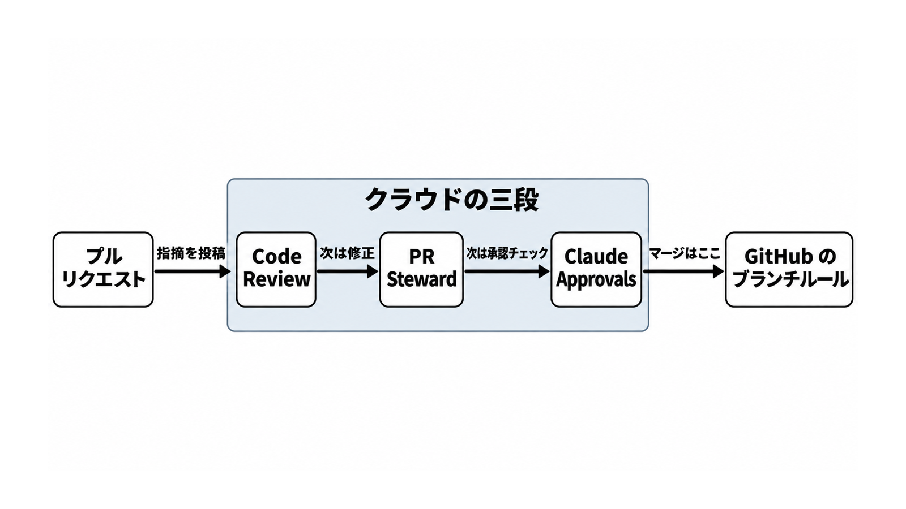

# Claude ShipはPRの指摘と修正とポリシー承認を重ねる

元記事: [Claude ShipはPRの指摘と修正とポリシー承認を重ねる](../../../../../articles/anthropic-claude-ship-pr-p1_20261125.md)

## ひとことで言うと

Claude Shipは指摘と修正と承認チェックを重ね、マージはGitHubが実行します。

## 核心ポイント

- Code Review は、差分の指摘をプルリクエストへ投稿します。
- PR Steward は、失敗した自動検査や直せる指摘をコミットで直します。
- 適用される承認条件は、既定ブランチのポリシーだけです。
- ポリシーが承認を許すとき、GitHub が求める人数に Claude の承認が1人分入りえます。
- 手元の /ship の公式の完了は、自分でマージすることです。

## メンタルモデル

枠のクラウドは、GitHub 上の Claude です。枠は右端の前で終わります。

## 具体例

ドキュメントの例の結果です。

| 条件 | 結果 |
| --- | --- |
| 全ファイルでレビューが pass | pass なら人数は1人に減り、作者でも足ります。Claude も承認しえます。 |
| `.claude`（承認ルールの場所）配下 | そこでは承認せず、人数は2人のままです。 |
| observe（多くは止めない）の行を消す | 必須チェックのときだけ、マージが止まります。 |

## 適用と判断

向く場面:

- Team か Enterprise の GitHub へ三段を足す前です。
- 既定ブランチへ observe のポリシーを置くときです。

確認すること:

- observe のままですか。
- Approvals のチェックを、GitHub の必須にしていますか。
- 作者を外すとき、機械ユーザーのログインも外していますか。
- 人を要しないポリシーと、自動マージかマージキューを同時に足していますか。
- 指摘を閉じた人を承認の根拠にしていますか。

## 限界・注意点

- ゼロデータ保持、HIPAA、顧客管理鍵では、三段は使えません。
- 2026年10月15日までの「承認は出さない」は、2026年11月23日の製品には当てはまりません。
- Anthropic 上の修正は、承認の操作を拒否します。自分のランナーでは、その場の GitHub 資格情報による承認を必須数に数ええます。
- ドキュメントの例では、人が指摘を閉じただけでは pass になりません。
- レート制限の数値と、revert が増えたら承認を締める回路は、参照した文書にありません。

## 参考

- [Claude ShipはPRの指摘と修正とポリシー承認を重ねる](../../../../../articles/anthropic-claude-ship-pr-p1_20261125.md)
- [Claude Ship の発表（2026-11-23）](https://claude.com/resources/articles/introducing-claude-ship)
- [Claude Ship の製品ドキュメント](https://code.claude.com/docs/en/claude-ship.md)
- [承認ポリシー](https://code.claude.com/docs/en/approvals-policy.md)
- [`/ship` コマンド](https://code.claude.com/docs/en/ship-command.md)
