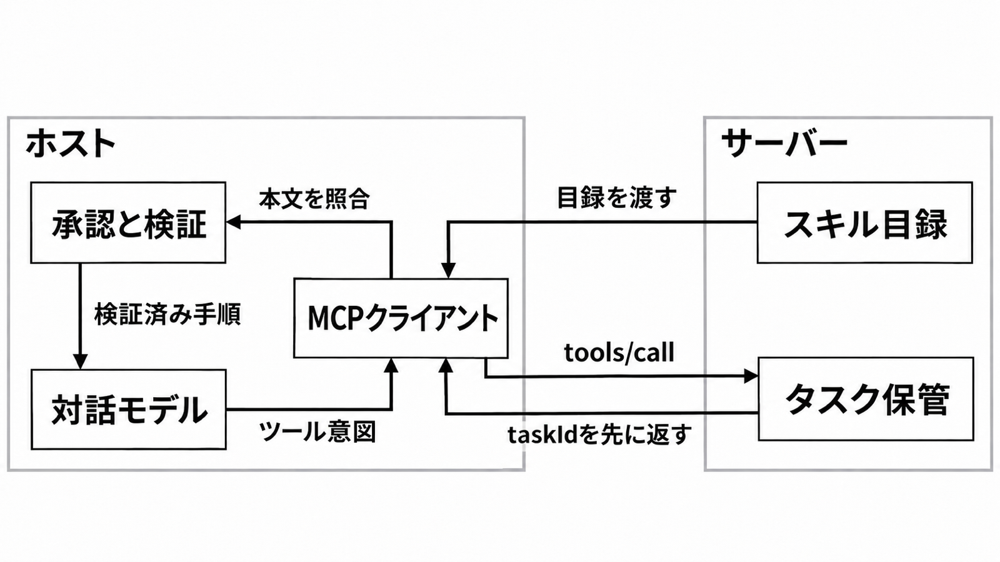

# ダイジェスト: MCPのSkillsとTasksでホストとサーバーの作業を受け渡す

[元記事](../../../../../articles/anthropic-mcp-skills-tasks-p6_20261125.md)

## ひとことで言うと

MCP（ホストとサーバーのやり取り）は、手順を配り、長い仕事は識別子を先に返します。

## 核心ポイント

- スキルの一覧では、名前と説明とファイル目録が先に届きます。本文は、検証と必要な承認のあとに載せます。
- スキルの身元は、ホストが接続先に付けたラベルと URI の組です。名前は一意ではありません。
- タスクにするかは、呼び出しごとにサーバーが決めます。対象は 2026-07-28 では tools/call だけです。
- 仕事の終わりは、completed、failed、cancelled だけです。状態を聞いた返事の complete は、仕事の終わりではありません。
- 短い結果は同期の tools/call です。待ちは Tasks、利用者への確認は別にします。

## メンタルモデル

左がホスト、右がサーバーの枠です。矢印の文言が、渡すものと返すものを示します。

## 具体例

公式フローの hello_world は、応答で taskId を返します。完了後の tasks/get は Hello, Luca! を返します。

## 適用と判断

向く場面:

- 業務手順をツールと同時に配るときです。
- 完了まで時間がかかる仕事を渡すときです。
- 課金、削除、破壊的変更の直前に確認を挟むときです。

確認項目:

- 作成応答のあと、tasks/get で中身を見ますか。
- 入力を送った返事が空でも、tasks/get で見ますか。
- 未回答の入力が残る間、待ちますか。

## 限界・注意点

- モデルに読ませずにファイルを渡す機能は、まだ草案です。Claude では展開前です。
- Task ID を失うと、結果をプロトコル上で回収できません。
- ツール結果の失敗は completed に入ります。failed は実行中のプロトコル誤りです。
- Claude Code（コーディングエージェント）では、Skills と Tasks の条件が違います。版、ログイン、セッションを別々に見ます。
- MCP skills では、自分で始めた Desktop のローカルセッションが使えます。コネクタと拡張は使えず、境目は分かっていません。

## 参考

- 元記事: [anthropic-mcp-skills-tasks-p6_20261125.md](../../../../../articles/anthropic-mcp-skills-tasks-p6_20261125.md)
- [Claude の告知記事](https://claude.com/resources/articles/skills-over-mcp-tasks-and-more)
- [Skills overview](https://modelcontextprotocol.io/extensions/skills/overview)
- [Tasks 仕様 2026-07-28](https://tasks.extensions.modelcontextprotocol.io/specification/2026-07-28/tasks)
- [Claude Code MCP](https://code.claude.com/docs/en/mcp)
