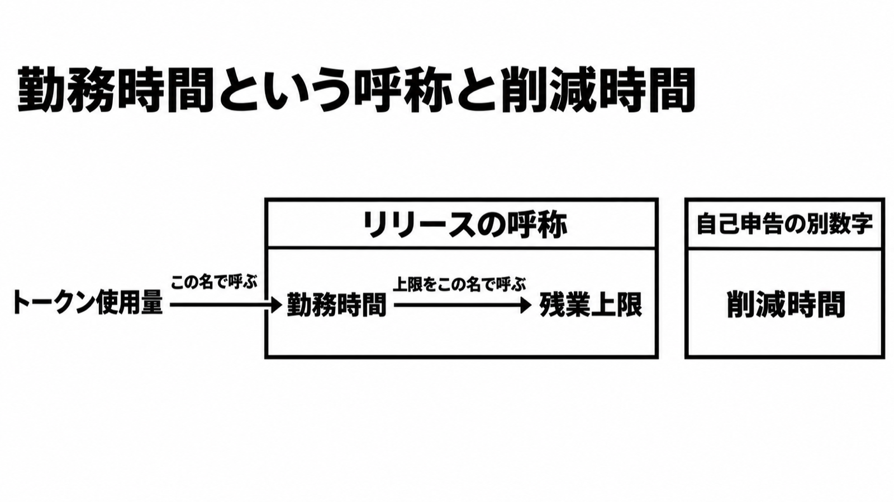

# ダイジェスト: DeNAのAI社員はトークン使用量を勤務時間、上限を残業上限と呼ぶ

[元記事](../../../../../articles/dena-itmedia-co-jp-aiplus-p3_20261125.md)

## ひとことで言うと

DeNAのAI社員（部署のエージェント）は、トークン使用量を勤務時間、上限を残業上限と呼びます。

## 核心ポイント

- アカウントは、個人に紐づかないエージェント用です。
- 削減時間は、AI社員が見積もった、人がやらなくて済んだ時間です。
- 約52.6時間は、会計システム担当のAI社員が、8営業日の自分の日報と週報で見積もった削減時間です。
- 破棄するか、保留するか、人が再開するかは、公開されていません。
- 契約、発注、採用の最終判断は、人に残します。

## メンタルモデル

トークン使用量から、リリース（発表文）の呼称の枠へ矢印が向きます。削減時間の枠には、矢印が入りません。

## 具体例

先の約52.6時間は、そのAI社員の月の代表値ではありません。

## 適用と判断

向く場面:

- AI社員の30人と17体を、同じ時点の人数と読む前です。
- 削減時間を、いつもの成果として書く前です。
- 上限の呼称を、停止手順として写す前です。

確認項目:

- 上限の期間と閾値を決める人を名指ししましたか。
- 上限に達した未完了は、保留して人が再開すると書きましたか。
- 人の評価に、勤務時間と呼ぶ消費を混ぜていませんか。
- アカウントの発行主体を、契約の一文にしましたか。
- 費用、成果、勤務時間へ写した消費を三行に分けましたか。

## 限界・注意点

- 勤務時間について公開されているのは、呼称までです。
- 30人と17体の差を説明する名簿は、公開されていません。
- Teams で頼めるかは、近日対応と、頼めるという説明に分かれます。
- 発行主体は、導入企業と書く資料と、提供側と書く資料があります。
- 料金は、初期費用と、使った分を含む月額です。

## 参考

- 元記事: [dena-itmedia-co-jp-aiplus-p3_20261125.md](../../../../../articles/dena-itmedia-co-jp-aiplus-p3_20261125.md)
- [DeNAニュースリリース「AI社員 by DeNA」（2026-11-20）](https://dena.com/jp/news/5481/)
- [サービスサイト「AI社員 by DeNA」](https://ai-shain.dena.com/)
- [DeNA Engineering「同僚として組織に迎える」（2026-08-04）](https://engineering.dena.com/blog/2026/08/ai-employee-introduction/)
- [公式note「17体の1か月」（2026-11-10）](https://note.com/dena_ai_shain/n/n52664780a88f)
