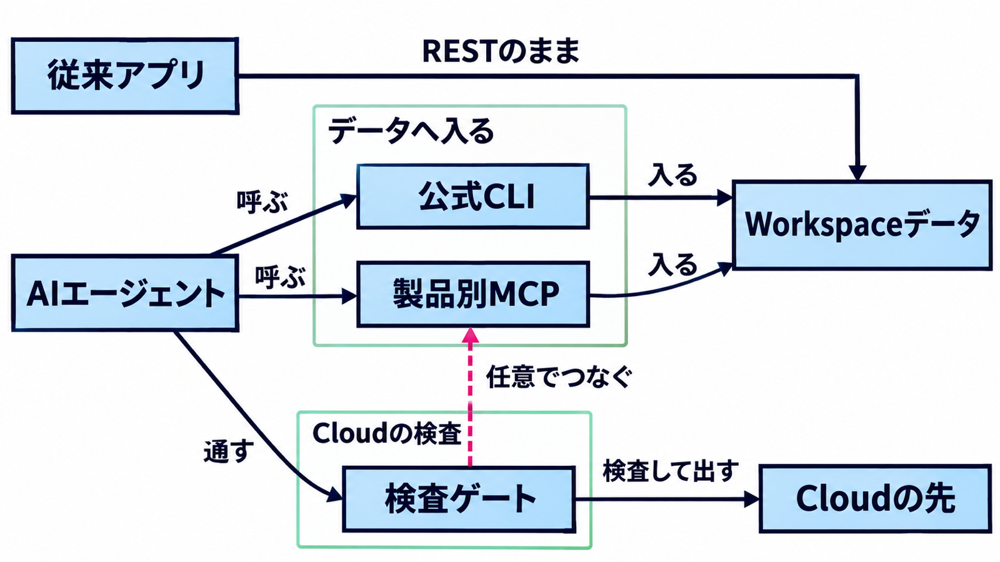

# Workspaceへ入る入口とCloudの通信検査

元記事: [Workspaceへ入る入口とCloudの通信検査](../../../../../articles/google-workspace-mcp-cli-p2_20261125.md)

## ひとことで言うと

データへ入るのは製品ごとの規約と公式のコマンドです。Cloudの通信検査は別です。

## 核心ポイント

- 検査ゲート（Cloudの通信検査）は、Gemini Enterpriseで選ぶときだけ製品別の規約へつなぎます。
- 呼び出しのたびに、利用者の権限と既存のユーザー単位のデータ損失防止と分類ラベルを見ます。
- 利用者に代わって入るには、エージェント用と宣言した認可クライアントが要ります。
- 外部エージェントの共有を伴う書き込みは、既定で人の確認が入ります。
- 2027年2月1日から、エージェント等のREST直呼びは、有料でも標準の上限へ制限されます。

## メンタルモデル

下から上の矢印が、選ぶときの接続です。右下はCloudの道具への出口です。

## 具体例

2027年4月1日からの課金です。2月の上限とは別で、RESTは従来アプリも含みます。

| 対象 | 課金 |
| --- | --- |
| Gmail、Calendar、DriveのREST | 請求先ごとに、1日の無料分を超えた分です。 |
| 同じ3製品を有料にしたMCP | 成功の最初からです。 |
| 公式CLI | 起動の料金は無く、使用量に数えます。 |

## 適用と判断

向く場面:

- クラウド上のエージェントからWorkspaceを呼ぶときです。
- 端末、VM、コンテナから公式CLIで入るときです。
- エージェントと従来アプリの入口を分けて持つときです。

確認すること:

- 確認を断られたら、別の道具で書き直していませんか。
- 呼び出し元は、エージェントかどうか分けましたか。
- 有料にする選択は、プロジェクト全体ですか。

## 限界・注意点

- 公式CLIだけで契約上のMCP要件を満たすかは、契約の読み方です。
- 検査ゲートは、実行環境によって提供段階が違います。
- サービスアカウントの委任は、管理者の設定で決まります。
- 埋め込みや索引などの技術情報の保存は30日までです。
- 接続を切ったときと失効したときは、利用者のデータと技術情報を残してはなりません。

## 参考

- [Google Workspace MCPとCLIの一般提供とAgent Gatewayの検査](../../../../../articles/google-workspace-mcp-cli-p2_20261125.md)
- [Workspace Updates（2026-11-24）](https://workspaceupdates.googleblog.com/2026/11/mcp-servers-cli-standardized-usage-tiers-now-available.html)
- [MCP サーバーの設定](https://developers.google.com/workspace/guides/configure-mcp-servers)
- [Workspace AI Tools Addendum](https://workspace.google.com/terms/ai-tools)
- [Agent Gateway 概要](https://docs.cloud.google.com/gemini-enterprise-agent-platform/govern/gateways/agent-gateway-overview)
