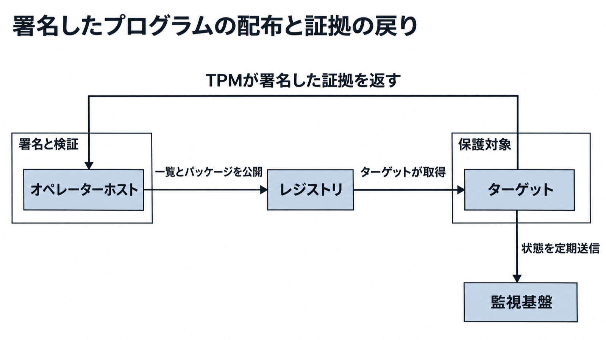

# ダイジェスト: Shirudoの配布と証拠

[元記事](../../../../../articles/shirudo_20261125.md)

## ひとことで言うと

OpenAIとCiscoのShirudoは、承認した小さなプログラムを稼働中のLinuxへ配り、適用を証拠で確かめます。

## 核心ポイント

- Shirudoは、署名した小さなプログラムを稼働中のLinuxへ読み込みます。
- 署名鍵はオペレーターホストに置き、対象マシンへは検証用の公開情報を渡します。
- 状態報告、TPM（計測用のチップ）の証拠、適用済みと適用待ちと未確定の表は、別々に見ます。
- 読み込んだかは、そのプログラムの読み込みを含む期待履歴とTPMの証拠の一致で判断します。
- 配布の最新まで進んでも、見送りにした機器は適用済みになりません。

## メンタルモデル

図は左から右へ読みます。左がオペレーターホスト、右のターゲットは対象マシンです。

## 具体例

記事の架空例では、配られた最新は12です。node-aは12まで適用済みで、node-bは9のまま適用待ちです。

## 適用と判断

向く場面:

- 本番の修正を試験している間も、サービスを止めたくないときです。
- 配布後に、対象ホストが追いついたか分けて見たいときです。
- 再起動せず、問題のある入力だけ拒みたいときです。

確認すること:

- 対象カーネルは、署名検証とShirudo用の改修を備えていますか。
- 対象マシンにTPM 2.0はありますか。
- 機器は、計測チップの鍵の識別子で登録していますか。
- 監視は JSON の status と reason を見ますか。
- 外す前に、守っている問題を全部、恒久修正か代替で確かめましたか。

## 限界・注意点

- 2026年11月25日時点で、安定リリースとサポート対象のリリースブランチはまだありません。
- ある入力を防げるかは、そのプログラムのテスト結果が要ります。
- 稼働中のJavaプロセスへ後から入れた例は、制御下の試験だけです。
- 自社のカーネルと起動構成への適合は、個別の評価が要ります。

## 参考

- [元記事](../../../../../articles/shirudo_20261125.md)
- [OpenAI の発表](https://openai.com/index/introducing-shirudo/)
- [Cisco の発表](https://newsroom.cisco.com/c/r/newsroom/en/us/a/y2026/m11/cisco-and-openai-launch-shirudo-a-new-project-to-safeguard-agentic-ai.html)
- [動作原理](https://docs.shirudo.dev/start/how-it-works.html)
- [セキュリティモデル](https://docs.shirudo.dev/security/security-model.html)
