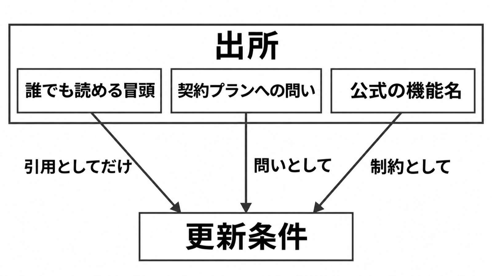

# ダイジェスト: 日経の冒頭は、契約更新の必須条件にはできない

[元記事](../../../../../articles/xtech-nikkei-atcl-nxt-mag-p8_20261125.md)

## ひとことで言うと

日経の誰でも読める冒頭は、Claude の管理機能への期待までです。その文は契約の必須条件にはなりません。

## 核心ポイント

- 2026年11月24日の誰でも読める冒頭の期待は、管理・運用機能の拡充までです。
- 2026年10月14日のウェブ版の語は、管理・運用基盤です。2026年11月24日の雑誌版の語は、管理・運用機能です。
- 誰でも読める部分に無い語は、停止、監査、担当の可視性です。これらの語は日経の引用にはできません。
- 先に書くのは、監査ログを書き出せる役割、1回でまとめる範囲、支出の上限です。確認を通さず動かすモードを止める設定も書きます。
- 外部への接続先を限れるかと、方針を一斉に配れるかは、契約プランへの問いとして書きます。

## メンタルモデル

上の枠が出所、下が更新条件です。
矢印の語は、条件へ書くときの形です。

## 具体例

監査ログを出せるのは Enterprise だけです。
Owner と Primary Owner が Export logs で、過去180日分を1回で出します。
ダウンロードのリンクは24時間です。

## 適用と判断

向く場面:

- 誰でも読める冒頭を、契約更新の引用に使うときです。
- モデルの性能が同点のとき、欠ける機能名で棄却するときです。
- 契約プランへの問いを、更新条件へ書くときです。

確認すること:

- 日経の引用と、自社の提案を、分けて書いてありますか。
- 棄却理由に、欠ける公式の機能名を先に書いてありますか。
- 有料本文より前の見出しを、機能の公式名にしていませんか。

## 限界・注意点

- 有料本文は未読です。
- 実行中のセッションを1本止める機能は、開いた公式ページでは未確認です。未開のページにあるかは不明です。
- 社内アカウントでのログインは、別の問いで、方式は未決定です。
- 顧客が管理する暗号鍵を使う組織は、書き出しボタンでは出せません。出す経路は Compliance API（ボタン以外の経路）です。
- 開いた公式ページに、監査ログのファイル形式はありません。

## 参考

- 元記事: [xtech-nikkei-atcl-nxt-mag-p8_20261125.md](../../../../../articles/xtech-nikkei-atcl-nxt-mag-p8_20261125.md)
- [日経クロステック、雑誌版、2026-11-24](https://xtech.nikkei.com/atcl/nxt/mag/nc/18/111500581/111500003/)
- [日経クロステック、ウェブ版、2026-10-14](https://xtech.nikkei.com/atcl/nxt/column/18/03757/100600003/)
- [市原尚久、2026-05-25](https://speakerdeck.com/naoichihara/agentic-aishi-dai-niokeru-merukarinoaigabanansutogadorerushi-zhuang)
- [Access audit logs](https://support.claude.com/en/articles/9970975-access-audit-logs)
