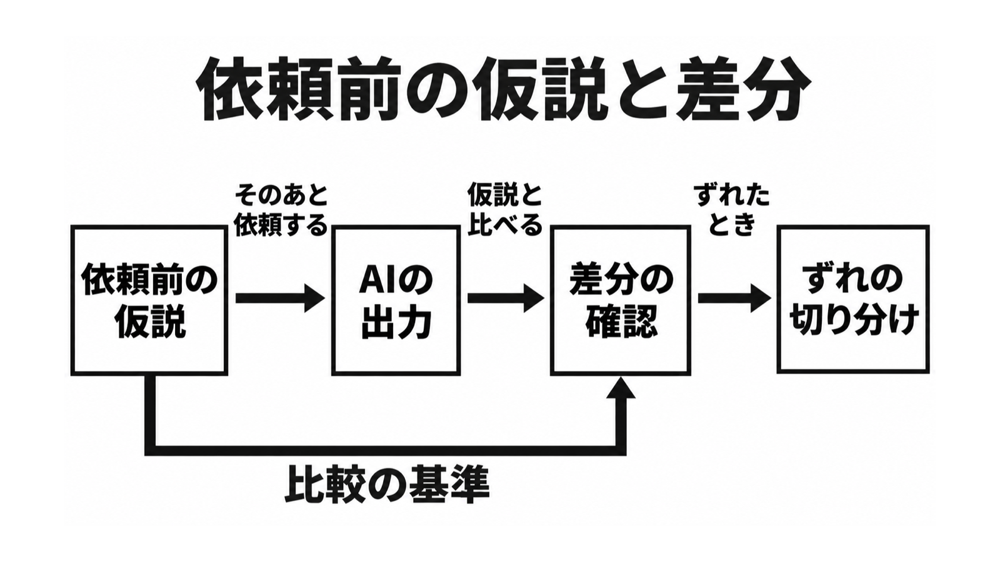

# ダイジェスト: 工程に足したAIと全体の体感

[元記事](../../../../../articles/ai-speakerdeck-yuukiyo-building-p7_20261126.md)

## ひとことで言うと

吉田祐樹氏の講演資料は、各工程にAIを足すと少しずつ速くなる体感で、全体が速くなった実感は薄いです。

## 核心ポイント

- 認知的降伏は、AIの出力をほとんど吟味せず自分の答えにすることです。
- 講演資料は、依頼の前に完了条件とトレードオフの仮説を置きます。出力はその仮説との差分として読みます。
- 講演資料は、各班が最低1日1回、班をまたいで全体へ説明し、フィードバックをもらうことを置きます。

## メンタルモデル

図は左から右へ読みます。右端の切り分けは、ずれたとき仮説と出力のどちらが違うかです。

## 具体例

認知的降伏の一例は、AIが書いた文を吟味せず他者へ転送することです。

## 適用と判断

向く場面:

- 自動化の範囲を決める前です。
- 依頼の前に完了条件を書いていないときです。

確認すること:

- 人がまだ止めているゲートの直近数件は、結論を変えましたか。
- 結論を変えていないゲートは、AIの文の転送ですか。
- 結論を変えていないゲートは、要約だけの判断ですか。
- 結論を変えていないゲートは、AIが出した設計のそのまま採用ですか。

## 限界・注意点

- この講演資料に、リードタイムや速度比はありません。
- 説明が1日1回でも、中身がAIの文の転送のままかは別です。
- 日次の説明と依頼前の仮説が、認知的降伏を防いだ率は、測定結果ではありません。
- 仮説を先に置くには、ある程度の経験が要ります。
- 仮説を先に置くことと、やってから考えることの、どちらが既定かは未測定です。

## 参考

- [元記事](../../../../../articles/ai-speakerdeck-yuukiyo-building-p7_20261126.md)
- [吉田祐樹氏の講演資料](https://speakerdeck.com/yuukiyo/building-teams-that-resist-cognitive-surrender-in-ai-dlc)
