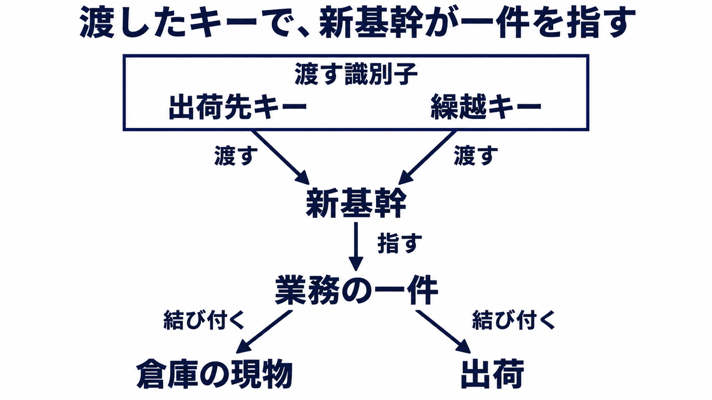

# ダイジェスト: 切替完了は、渡したキーで一件を指せるところまで

[元記事](../../../../../articles/s-hana-xtech-nikkei-atcl-p3_20261126.md)

## ひとことで言うと

切替完了は、新基幹の起動に加え、出荷と繰越で渡したキーが一意に一件を指すまでです。

## 核心ポイント

- TOYO TIREの日本の初期トラブルは、1月から6月の営業利益影響が42億円です。
- 出荷先が分からないことは公開の冒頭、繰越が反映されないことは次の見出しです。二つの決算説明をテキスト化した範囲では、この障害の説明にその語はありません。
- 42億円の内訳は、販売23億円と製造19億円です。
- 2026年1月の日本拠点の移行で、国内向けの出荷が乱れました。

## メンタルモデル

上の二つは、新基幹へ渡す識別子です。
新基幹から一件を指し、その一件が倉庫の現物と出荷に結び付きます。

## 具体例

| 行 | 指しているもの |
| --- | --- |
| 42億円 | 1月から6月の営業利益影響 |
| 関税の42億円 | 四半期ごとの別の行 |
| 約107億円 | 上期の営業利益の減少で、別の行 |

## 適用と判断

向く場面:

- 基幹切替の完了を、起動の先まで決めるときです。
- 出荷と繰越の試験を、切替前に置くときです。
- 42億円を営業利益影響として引用するときです。

確認すること:

- 出荷先が空なら、切替前に不合格としますか。
- 月の途中でも、繰越と未出荷が翌月の同じ一件に残りますか。
- キーと、指す一件と、空で止まる業務を台帳に残しますか。
- 42億円を、在庫の簿価と別の行に書きましたか。
- 42億円の引用を、この会社の事例に限っていますか。

## 限界・注意点

- キーの合格は、運用を基幹の手順へ合わせ終えたことまでは含みません。
- 想定を超える受注で処理が追いつくかは、キーの空欄を見る試験では分かりません。
- 製造19億円は、四半期への配分には使いません。
- 月またぎの見出しが、この会社の障害かは確定できません。
- 有料本文が、出荷先が分からないことをこの会社の事象ではないと書いていれば、出荷の試験は仮説に戻します。

## 参考

- 元記事: [s-hana-xtech-nikkei-atcl-p3_20261126.md](../../../../../articles/s-hana-xtech-nikkei-atcl-p3_20261126.md)
- [日経クロステック公開リード](https://xtech.nikkei.com/atcl/nxt/mag/nc/18/111600582/111600001/)
- [同記事の次ページ見出し](https://xtech.nikkei.com/atcl/nxt/mag/nc/18/111600582/111600001/?P=2)
- [TOYO TIRE 2026年度第2四半期決算説明（2026-08-07）](https://tdnet-pdf.kabutan.jp/20260807/140120260805510279.pdf)
- [TOYO TIRE 2026年度第3四半期決算説明（2026-11-16）](https://www.release.tdnet.info/inbs/140120261113580356.pdf)
