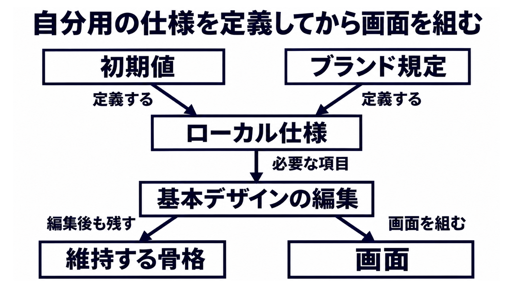

# ダイジェスト: 自分用の仕様を定義してから使う

[元記事](../../../../../articles/digital-agency-go-jp-2026-p9_20261127.md)

## ひとことで言うと

デジタル庁デザインシステムは、導入先が自分用の仕様を定義してから使います。

## 核心ポイント

- ローカル仕様（導入先の仕様）は、初期値と、導入先のブランドの決まりから定義します。
- 変更が不要な項目は、配られた初期値のまま使えます。
- 見た目を編集したあとも残すのは、文字と文字以外のコントラスト、意味を持つ色の色相、キーボードで今いる場所の黄と黒です。
- 部品のコードを変えるときも、置き換わった色での境界と状態と、読み上げへ伝える役割と状態は残します。
- 文字サイズ、行の高さ、操作領域は、一つの共通の合格値ではありません。

## メンタルモデル

基本デザインの編集は、色や文字など必要な見た目の編集です。
維持する骨格は、編集したあとに残す条件の枠です。

## 具体例

| 対象 | 条件 |
| --- | --- |
| 本文と UI の文字 | 基準は 16px。難しいときだけ 14px。14px 未満は原則として不可 |
| 読み物本文の行高 | 読み物本文は文字サイズの 1.5 倍以上。情報量を優先する画面では狭めてよい |
| ボタンとほかのリンク | ボタンは隣と重ならない少なくとも 44px 四方。ボタン以外のリンクは、44px を確保できないときも少なくとも 24px 四方 |

## 適用と判断

向く場面:

- デジタル庁のデザインシステムを導入先へ入れるときです。
- 発注書に残す条件の一覧を書くときです。
- 一つの掲載数値を、全ページ共通の合格値にする前です。

確認すること:

- 納品物は、導入先のブランドとサービスに合わせた仕様ですか。
- 初期値のまま残す項目と、上書きする項目は分かれていますか。

## 限界・注意点

- 骨格を守ることは、ウェブのアクセシビリティ規格への適合証明とは別です。
- 中央省庁の調達は、このデザインシステムの採用が原則です。未改変で納品する義務でも、自分用仕様を作れという指示でもありません。
- 配布パッケージ 2.1.0 の対応表は、Figma のデザインデータ 2.18.1 までです。
- その原則の根拠条文は、未確認です。

## 参考

- 元記事: [digital-agency-go-jp-2026-p9_20261127.md](../../../../../articles/digital-agency-go-jp-2026-p9_20261127.md)
- [導入先の仕様の公式ページ](https://design.digital.go.jp/dads/guidance/local-design-system/)
- [デジタル庁ニュース（2026-11-26）](https://digital-agency-news.digital.go.jp/articles/2026-11-26)
- [使い方 PDF（2026-08-06）](https://www.digital.go.jp/assets/contents/node/basic_page/field_ref_resources/79b783f4-5265-4044-a374-f8f6ccd6e5da/d3abed7f/20260806_meeting_How-to-use-DADS_outline_04.pdf)
- [試験結果](https://design.digital.go.jp/dads/webaccessibility/result/)
