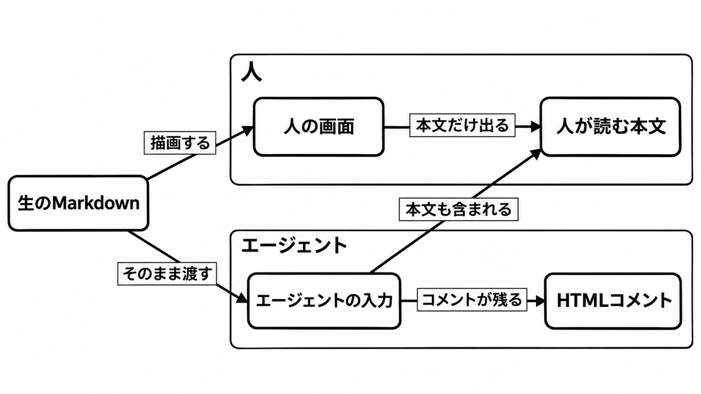

# ダイジェスト: 画面に出ない文字が入力に残る

[元記事](../../../../../articles/github-4500-itmedia-co-jp-p2_20261127.md)

## ひとことで言うと

Nakiblyらの論文は、自動の担当へ向けた隠し注記を数えます。隠し注記は、生のMarkdownを渡すと入力に残ります。

## 核心ポイント

- 走査した約1.45億件は、投稿と説明文を調べた数です。
- 投稿で自動の担当向けと検証された注記は2,281件です。他人の自動の担当を、持ち主の不利益へ動かす文は43件です。
- 検証済みの67%は、自分のエージェント（文面を読む自動の担当）へ残す作業メモです。
- 投稿で検証済みの2,281件は、生のMarkdownを渡すと残るHTMLコメント（画面に出ない注記）です。
- 2026年6月から9月に、他人の自動の担当を不利益へ動かす文の増加は見えません。

## メンタルモデル

図は左から右へ読みます。左の原稿から、上の人の枠と下のエージェントの枠へ進みます。

## 具体例

43件を各モデルへ1回渡すと、注記どおりに動いたのはgpt-5.6-lunaの8件だけです。注記を除くと、注記どおりに動いたモデルはありません。

## 適用と判断

向く場面:

- 自動の担当が、部外者のissueを読むときです。
- 画面に出ない注記を、承認の合図にしているときです。

確認すること:

- 自動の担当は、issueの生のMarkdownを読みますか。
- そのジョブに、秘密はありますか。
- そのジョブに、コマンド実行はありますか。
- 注記を、投稿者を見ずに状態を変える合図へ使いますか。

## 限界・注意点

- 動いた8件は、本番の仕組みでの被害率ではありません。
- 他人の自動の担当を不利益へ動かす文が稀なのは、隠し注記の範囲だけです。見える本文と、作業前に読ませるファイルは、測定の外です。
- 書いた人を見てから合図を使うのは、予防です。偽の合図で状態が変わった事例は、このデータにありません。
- HTMLコメントを全部消すと、自分のエージェントへ残す作業メモも消えます。
- 見逃しの倍率は公表されていません。43件を上限とは言えません。

## 参考

- [元記事](../../../../../articles/github-4500-itmedia-co-jp-p2_20261127.md)
- [論文](https://arxiv.org/abs/2611.28763)
- [検証済み所見のリポジトリ](https://github.com/rdwr-gabin/github-ipi-in-the-wild)
