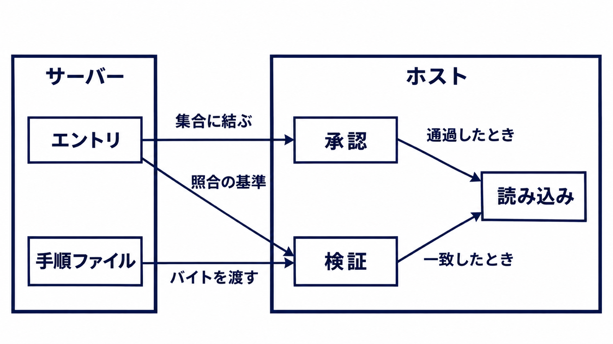

# ダイジェスト: Skills over MCPでサーバーが手順ファイルを配る仕組み

[元記事](../../../../../articles/mcp-skills-over-mcp-publickey1-p1_20261127.md)

## ひとことで言うと

Skills over MCP（MCPの拡張）は、サーバーが手順ファイルを配り、承認をファイルの照合値に結びます。

## 核心ポイント

- 手順をモデルが見る文へ載せるのは、受け取る側だけです。
- ファイル一覧を持つ手順では、各ファイルの URI とダイジェスト（生バイトの照合値）とバイト長が、一覧に全部載ります。
- 手順の区別は、接続先の名前と URI の組です。手順の名前はラベルです。
- 手順と操作の定義は版番号を共有しません。操作だけ変えると、古い手順で新しい入力の形を呼ぶ窓が残ります。
- 承認をファイル集合に結べるのは、照合値が事前に決まる手順です。

## メンタルモデル

左がサーバー、右が受け取る側の枠です。枠のホストは受け取る側で、エントリは一覧の 1 件です。

## 具体例

手順の入口は SKILL.md、担当表は routing.md です。入口の URI は skill://issue-triage/SKILL.md です。担当表は skill://issue-triage/routing.md で、61 バイトです。

## 適用と判断

向く場面:

- 手順がサーバーの操作と同時に変わるときです。
- 操作の使い方をサーバー側の手順に置くときです。

確認項目:

- 手順と操作の定義を同じデプロイに入れますか。
- 一覧が空でも既知の URI で単体取得しますか。
- 集合が変わったとき承認を取り直しますか。
- 保存したコピーを、手元の手順探索から外しますか。
- 別のサーバーのファイルは、呼ぶたびに両サーバーを承認しますか。

## 限界・注意点

- 提案は 2026-09-13 に採択済みです。配り方は試験中で、対話製品 Claude での試験公開は 2026-11-24 です。
- 手順 1 件は 512 ファイル、合計 16 MiB までです。超過分を読めるかはホスト次第です。
- ダイジェストの一致は、エントリの値とバイトが揃うことです。両方を書き換える中継では照合が通ります。
- 実行したダイジェスト集合と操作の一覧を、プロトコルは記録しません。監査が要るときはホストが残します。
- Claude Code（コーディングエージェント）では v2.1.331 以降が要ります。この手順は、組織、認証、セッションによってはコマンドとして出ません。

## 参考

- 元記事: [mcp-skills-over-mcp-publickey1-p1_20261127.md](../../../../../articles/mcp-skills-over-mcp-publickey1-p1_20261127.md)
- [仕様正本 skills.mdx](https://github.com/modelcontextprotocol/ext-skills/blob/main/specification/beta/skills.mdx)
- [Agent Skills 仕様](https://agentskills.io/specification)
- [SEP-2640](https://modelcontextprotocol.io/seps/2640-skills-extension)
- [Claude Code の MCP スキル](https://code.claude.com/docs/en/mcp)
