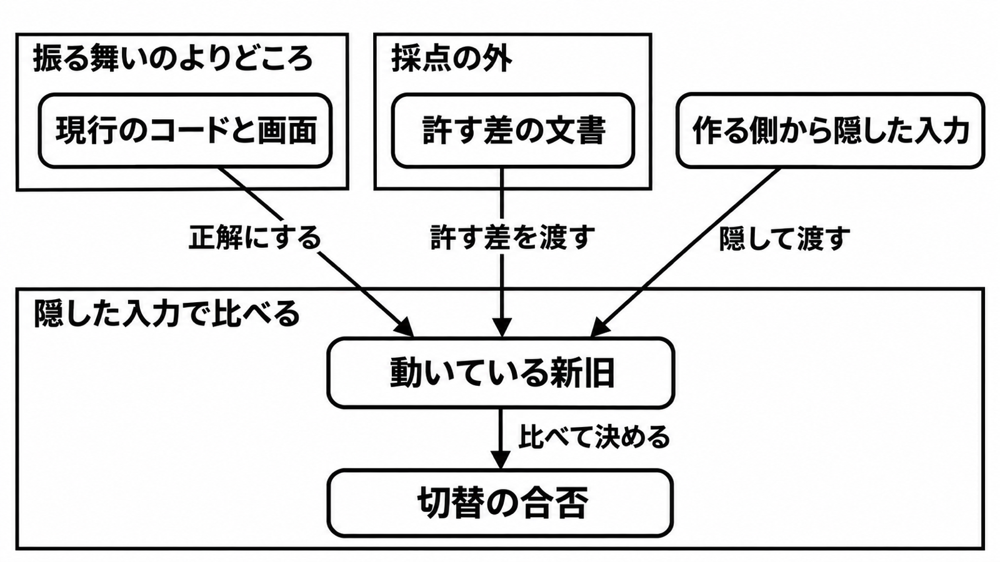

# ダイジェスト: 正解と許す違いと合否を分ける

[元記事](../../../../../articles/960-speakerdeck-tkyowa-kakaku-p1_20261128.md)

## ひとことで言うと

この記事は、比較の正解と、許す違いと許さない違いと、切替の合否を別に置きます。

## 核心ポイント

- 刷新はアプリとインフラを新しく作り、データベースの表構造と既存機能と業務ロジックは原則として維持します。
- 現行と同じ振る舞いが条件で、仕様書から作った内側のテストは書いていない違いを合格にします。
- 管理システム1件で、方式と生成AIの組をそれぞれ1回だけ比べました。
- 細かい工程と同じ生成AI（文章を生成するAI）で目標だけ渡した方式は、データベースに接続できていません。
- 価格.comの刷新で今も使うのは、細かい工程の方です。

## メンタルモデル

「振る舞いのよりどころ」は比較の正解、「採点の外」は許す違いと許さない違いの文書です。
下の外枠では、隠した入力の比較のあとに切替の合否を置きます。

## 具体例

| 見方 | 合格した件数 / 調べた件数 |
| --- | --- |
| 細かい工程の内側の自動テスト | 514/520 |
| 細かい工程の、外から見た振る舞い | 32/65 |
| 別の生成AIで目標だけ渡した、外から見た振る舞い | 65/65 |

## 適用と判断

向く場面:

- 現行と同じ振る舞いを、満たすべき条件にした作り直しです。
- 外からの採点が無いときです。
- 残りを増やす前に、手順を終えた画面も外から測るときです。

確認すること:

- テストは、現行から作った仕様書から作っていますか。
- 比較の正解は、動いている現行のコードと画面ですか。
- 許す違いと許さない違いは、採点の仕組みの外にありますか。
- 手順を終えたURLの割合を、切替の合否から外していますか。
- 作る側から隠した入力で、動いている新旧の振る舞いを比べましたか。

## 限界・注意点

- 2026年9月の本番はユーザー向け1カテゴリで、比べた管理システムとは別です。
- 切り替えを決める側は、非公開の自作採点を再実行できません。
- 外から見た点数の分母は、ページ数ともURLの数とも一致しません。
- 認証、認可、画面権限の移行は未確認です。
- 現行の不具合を正解に含めるかは、切り替えを決める側が別に決めます。

## 参考

- [元記事](../../../../../articles/960-speakerdeck-tkyowa-kakaku-p1_20261128.md)
- [京和崇行、時田充「価格.comのAI駆動による全面刷新の現在地と振り返り」](https://speakerdeck.com/tkyowa/kakaku-com-ai-driven-system-renewal-202611)
- [同資料の PDF](https://files.speakerdeck.com/presentations/9cf9a0552d5d4680bdec0fe2332f7a77/kakaku-com-ai-driven-system-renewal-202611.pdf)
