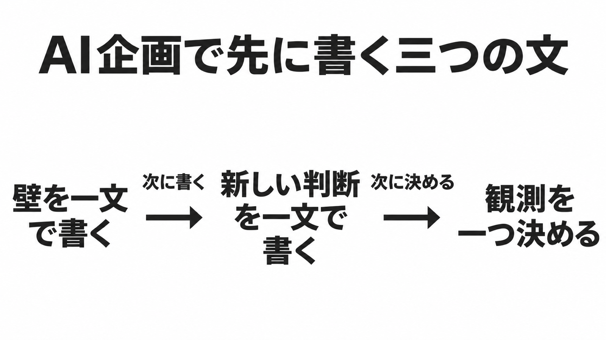

# ダイジェスト: 壁と新しい判断と観測を先に書く

[元記事](../../../../../articles/ai-only-value-four-walls-eight-k_20261128.md)

## ひとことで言うと

安宅和人さんの枠では、越えた壁と新しい判断と確かめる観測を先に書きます。

## 核心ポイント

- サンゴ礁の例では、世界中の画像は人手で調べきれません。
- サンゴ礁の地図では、分類した面積に砂地や海草も入ります。
- ダムの1%程度は、検証で見込んだ水系全体の発電量の増分です。
- AIが配車を提案できても、予約に合わせて走るバスには車両と運転手が要ります。

## メンタルモデル

左から右へ、壁、新しい判断、観測の順です。
各ラベルは、企画で先に書く一文です。

## 具体例

| 決めること | ダムでの問い |
| --- | --- |
| 新しい判断 | 運転員が前提を確認し、現場に合わせて採否を決められるか |
| AIが渡すもの | 流入量の予測を、運転員が比較できる運用案にできるか |
| 確かめる観測 | 条件をそろえた模擬で、水系全体の発電量に差があるか |

## 適用と判断

向く場面:

- 分類した面積を、そのまま成果にする前です。
- 複数の設備をまとめて運用する企画のときです。
- 少ない需要のサービスを続けられるか見るときです。

確認すること:

- 越えた壁を、一文で書けますか。
- 誰の新しい判断かを、一文で書けますか。
- その判断を確かめる観測は、一つですか。
- 比較する相手を書けますか。
- 費用が壁のとき、残る費用を書き出しましたか。

## 限界・注意点

- サンゴが今も生きているかは、この地図では分かりません。
- サンゴの生息場の95%信頼区間は、約4.6万から10.6万平方キロメートルです。
- 濁りの強い場所は、この地図の対象外です。
- 導入後の増分を見るには、運転記録と比較条件が要ります。

## 参考

- 元記事: [AIで初めて何ができるのかを「4つの壁と8つの価値」で考える](../../../../../articles/ai-only-value-four-walls-eight-k_20261128.md)
- [安宅和人「AIでしか生み出せない価値とは何か」](https://kaz-ataka.hatenablog.com/entry/2026/11/28/085335)
- [Lyonsらによる浅海サンゴ礁の全球マッピング](https://doi.org/10.1016/j.crsus.2024.100015)
- [北陸電力・JFEエンジニアリングによるダム運用支援の発表](https://www.rikuden.co.jp/press/attach/22101901.pdf)
- [国土交通白書2023](https://www.mlit.go.jp/hakusyo/mlit/r04/hakusho/r05/html/n1111000.html)
