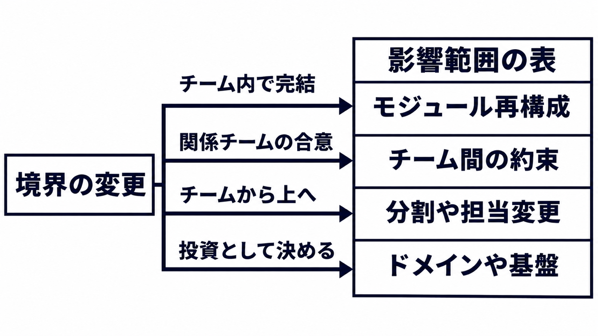

# ダイジェスト: 境界の最終判断は影響範囲で分ける

[元記事](../../../../../articles/ai-ryuzee-contents-14629-p4_20261128.md)

## ひとことで言うと

吉羽氏の資料は、境界の最終判断を影響範囲の4行で分けます。

## 核心ポイント

- コードを書く費用が下がったあとも、システムの切れ目を決めるのはチーム境界です。
- 最終判断は、影響範囲の4行で分かれます。行は、チーム内の再構成から、ドメインや基盤の切り出しまでです。
- 境界を越えた変更は、人とコードを書くAIに同じ検査で落とします。同じ変更なら、落ち方も同じです。
- 指示ファイル（手順を伝えるファイル）には、固有の手順と、表や判断記録（切れ目の理由）への参照を置きます。
- 可用性の厳しさや基盤の切り出しは、複数チームの運用責任か投資配分が変わるときだけ、表のいちばん下の行へ上げます。

## メンタルモデル

左の境界の変更から、右の枠の4行へ矢印が出ます。矢印の文言が、その行の最終判断です。

## 具体例

チーム内のモジュール再構成は、最終判断がチーム内で完結します。依存の規則を破って通す許可は、この行に含まれません。

## 適用と判断

向く場面:

- 切れ目の最終判断者を表に残すときです。
- 指示ファイルへ境界の規則を足す前です。
- 可用性の目標を、合格か不合格かに置き換える前です。

確認すること:

- 影響範囲の4行を、判断記録の隣に置いていますか。
- 下の行へ上げた変更は、複数チームの運用責任か投資配分が変わりますか。

## 限界・注意点

- 公開された保守性の数字は、チーム境界が原因だという証拠にはなりません。
- 境界を守ったかは、指示ファイルの調査では測っていません。
- 検査は、誤った切れ目も守ります。
- 毎日の差分を上位の承認へ上げる運用は、表の条件より広いです。
- 指示ファイルは、複数の境界を同時に守る役にはしません。

## 参考

- 元記事: [ai-ryuzee-contents-14629-p4_20261128.md](../../../../../articles/ai-ryuzee-contents-14629-p4_20261128.md)
- [吉羽龍太郎「コードを書くAI、アーキテクチャーを決める組織」](https://www.ryuzee.com/contents/blog/14629)
- [同スライド](https://slide.meguro.ryuzee.com/slides/141)
- [アーキテクチャConference 2026](https://architecture-con.findy-tools.io/2026)
