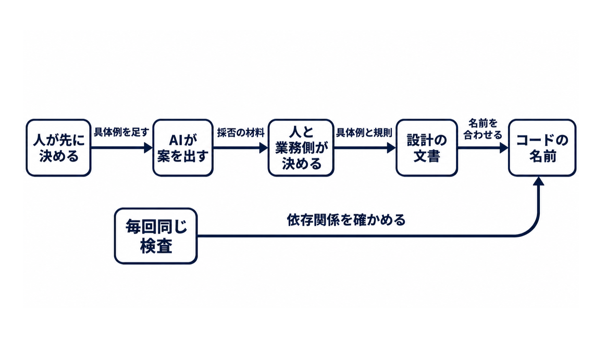

# ダイジェスト: コードの名前を、設計の文書へ合わせる

[元記事](../../../../../articles/ai-speakerdeck-littlehands-p3_20261128.md)

## ひとことで言うと

松岡幸一郎氏の資料は、コードの名前を、維持する設計の文書へ合わせます。

## 核心ポイント

- 実装が速くなったあとも、人の仕事は問題の理解と解決策と、確かめることに残ります。
- 人が先に図で決めるのは、誰がログインしどの外部とつながるか、最初の操作、具体的な値、用語と規則です。
- AIが出した具体例の採否は、描いた人と業務側が決めます。
- 実装へ渡す文は、採用した具体例、名前、繋がる個数、規則です。
- コードの名前は、維持すると決めた設計の文書へ極力合わせます。

## メンタルモデル

左端は、人が先に決めることです。右端のコードの名前へ、設計の文書と検査から矢印が入ります。

## 具体例

採用管理では、不合格の選考に面接を追加できないことが、採用した規則の例です。

## 適用と判断

向く場面:

- 実装が速くなり、人の残る仕事を決めるときです。
- 設計の文書と、コードの名前がずれているときです。

確認すること:

- 維持すると決めた設計の文書は、最新ですか。
- コードの依存関係は、機械で照合する検査ですか。
- 名前を合わせる相手は、維持すると決めた設計の文書ですか。

## 限界・注意点

- 図をどの形式で置くかは、資料から特定できません。
- 図の画像そのものは、文書へ写すためのものです。
- 2024年6月の手描きクラス図の実験では、写しに抜けと読み違えがありました。2026年の率は未測定です。
- 望む動きになるかは、検査の成功だけでは決まっていません。
- 今あるコードから設計を起こすやり方も、資料には残っています。

## 参考

- [元記事](../../../../../articles/ai-speakerdeck-littlehands-p3_20261128.md)
- [松岡幸一郎氏の登壇資料](https://speakerdeck.com/littlehands/umtp-suraido-20261125)
- [Eric Evans, Domain-Driven Design Reference](https://www.domainlanguage.com/wp-content/uploads/2016/05/DDD_Reference_2015-03.pdf)
- [Birgitta Böckeler, Harness engineering for coding agent users](https://martinfowler.com/articles/exploring-gen-ai/harness-engineering.html)
- [Conrardy と Cabot, From Image to UML](https://arxiv.org/abs/2404.11376)
