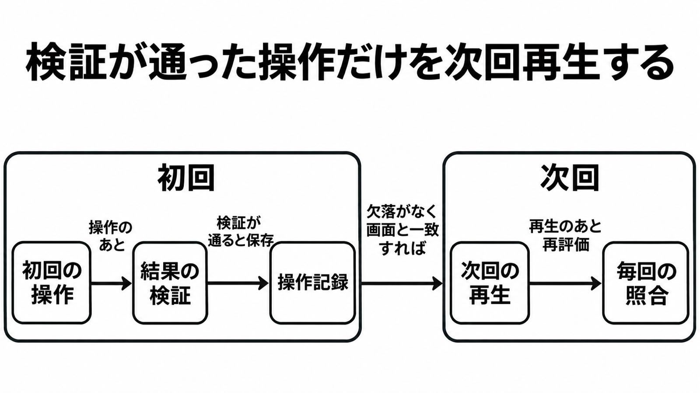

# ダイジェスト: 検証が通った操作だけを再生する

[元記事](../../../../../articles/e2e_20261128.md)

## ひとことで言うと

e2e（画面操作のテスト枠組み）0.25.0 は、検証が通った操作を記録して再生し、結果は毎回照合します。

## 核心ポイント

- ロケータ（要素の指定）の操作と照合は、モデルへ問い合わせません。
- 任せた操作の初回は、モデルが画面を見て選びます。記録が欠けておらず今の画面と一致すれば、次回は再生できます。
- 同じ文言の厳密な確認は、ロケータに置きます。
- CI の既定は、操作記録の読み取り専用です。
- 保存した操作が今の画面と違うと、strict-cache（不一致で失敗）では失敗します。

## メンタルモデル

図は左の初回から、右の次回へ読みます。矢印の画面は、今開いている画面です。

## 具体例

請求設定を開き、Pro への変更は初回だけモデルに任せます。状態欄の文字が Pro であることを照合します。

## 適用と判断

向く場面:

- 途中の画面に複数の正しい経路があるときです。
- 結果の文言を毎回同じ照合で固定したいときです。
- モデルを呼ばずに各コミットを判定したいときです。

確認すること:

- 共有する前に、記録へ残った入力文字を見ましたか。
- モデルを呼ばないジョブはロケータだけですか。
- 新しいテストの記録は CI にありますか。
- 料金変更の再実行は、毎回同じ初期プランからですか。

## 限界・注意点

- strict-cache でも、記録が無い新しいテストはモデルが操作を選びます。
- 文言の意味を読む確認は、実行のたびにモデルへ依頼します。
- 組み込みの、条件まで画面を観察する処理と値の抽出は、記録して再生しません。
- 入力した文字は、記録にそのまま残ります。
- 対象は e2e 0.25.0 です。他の版で記録条件が同じかは、記事にありません。

## 参考

- [元記事](../../../../../articles/e2e_20261128.md)
- [要素の指定とモデルの使い分け](https://e2e.com/docs/agentic-vs-deterministic.md)
- [操作記録の条件と再生](https://e2e.com/docs/cache.md)
- [CI での実行](https://e2e.com/docs/ci.md)
- [e2e のリポジトリ](https://github.com/e2e-inc/e2e)
