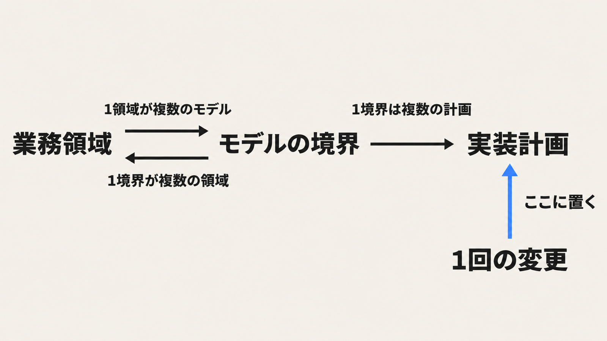

# ダイジェスト: エージェントへ渡す1回の変更は計画に置く

[元記事](../../../../../articles/khononov-ai-zenn-dev-koga-p2_20261128.md)

## ひとことで言うと

Khononov は、業務の知識と表し方と実装計画を分けます。

## 核心ポイント

- その業務の表し方は、知識の文書とは別に置きます。
- 1つの業務領域は、複数の表し方で書けます。
- 表し方の区切り1つは、複数の業務領域を反映できます。
- 表し方の区切り1つは、必ず複数の実装計画にまたがります。
- エージェントへ渡す1回の変更は、機能1つ分の実装計画に置きます。

## メンタルモデル

図の「モデル」は業務の表し方、真ん中の箱はその区切りです。
下から入る矢印が、1回の変更の向きです。

## 具体例

電子商取引では、商品や注文のような仕事を、業務領域へ束ねます。

## 適用と判断

向く場面:

- エージェントへ実装を1回渡すときです。

確認すること:

- 業務の知識は、実装計画とは別の文書にありますか。

## 限界・注意点

- この分け方でコードの劣化が止まる、とは測定されていません。
- 知識、表し方、実装計画を混ぜた方が影響範囲を追えると測られたら、この置き方をやめます。
- 実装計画の外へ設計のファイルを必ず出す道具で、そのファイルが表し方の区切りを担うなら、この置き方は向きません。
- 表し方を実装計画へ溶かすと、設計の置き場が消えます。

## 参考

- 元記事: [khononov-ai-zenn-dev-koga-p2_20261128.md](../../../../../articles/khononov-ai-zenn-dev-koga-p2_20261128.md)
- [講演スライド PDF](https://drive.google.com/uc?export=download&id=1b4IHT5jreUauZ1Ou4Bo9052DlgAoviwy)
- [コードの劣化を測った論文](https://arxiv.org/html/2603.24755)
- [仕様の形を比べた記事](https://martinfowler.com/articles/exploring-gen-ai/sdd-3-tools.html)
