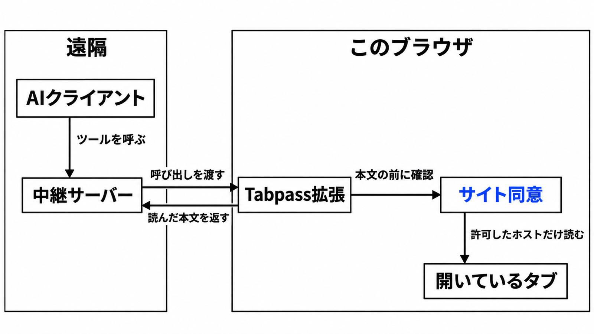

# ダイジェスト: Tabpassの接続と同意

[元記事](../../../../../articles/tabpass_20261128.md)

## ひとことで言うと

MigmaのTabpassは、手元のChromeタブを中継サーバー経由でAIに渡します。

## 核心ポイント

- AIはChromeの拡張へ直接届かず、中継サーバーへツール呼び出しを送ります。拡張は同じ中継へWebSocketでつながります。
- 見せるサイトと、フォーム操作やタブの開閉の許可は、別々に決めます。
- 接続を始めるリンクを持つ相手は、そのリンクで許したことまで、このブラウザに届きます。初めてのサイトは、別に承認が要ります。
- 拡張の画面でその接続を外すと、古いトークンでは新しい操作ができません。
- ページ本文は、呼び出しのあいだだけ中継を通ります。中継はその本文を保存しません。

## メンタルモデル

図は左から右へ読みます。左が遠隔の呼び出し、右がこのブラウザの中です。

## 具体例

サイトの確認で常時許可したサイトは、新しい接続でもすぐ読めます。10分だけの許可は、10分後か、Chromeを閉じると切れます。効くのは、その接続だけです。

## 適用と判断

向く場面:

- 開いている資料を、クラウドのAIに読ませたいときです。
- フォーム操作やタブの開閉まで任せるかを、接続ごとに分けたいときです。
- 自分で用意した中継に、本文を通したいときです。

確認すること:

- 調べものだけなら、読むだけの接続にしましたか。
- 常時許可は、繰り返し使うサイトだけですか。
- 接続を始めるリンクを、公開の場に置いていませんか。
- 自分で用意した中継へ移すとき、接続を作り直しましたか。

## 限界・注意点

- 通過中の本文は、中継を動かしている人から見えます。
- Migmaのチャット製品（Tabpassとは別の画面）で切っても、拡張の接続は残ります。
- 以後見せないと決めたサイトでも、AIが見る一覧にタブは残ります。
- Migmaのチャット製品は、同社の中継以外へ移せません。
- Google文書の実アカウントでの読み取りは、記事の対象にした版では未試験です。

## 参考

- [元記事](../../../../../articles/tabpass_20261128.md)
- [MigmaAI/tabpass](https://github.com/MigmaAI/tabpass)
- [README（cdbe95e）](https://github.com/MigmaAI/tabpass/blob/cdbe95ea5c7824b148aee347d454bb7f5b71f69b/README.md)
- [同意の実装](https://github.com/MigmaAI/tabpass/blob/cdbe95ea5c7824b148aee347d454bb7f5b71f69b/extension/public/lib/permissions.js)
- [プライバシーポリシー](https://github.com/MigmaAI/tabpass/blob/cdbe95ea5c7824b148aee347d454bb7f5b71f69b/PRIVACY.md)
