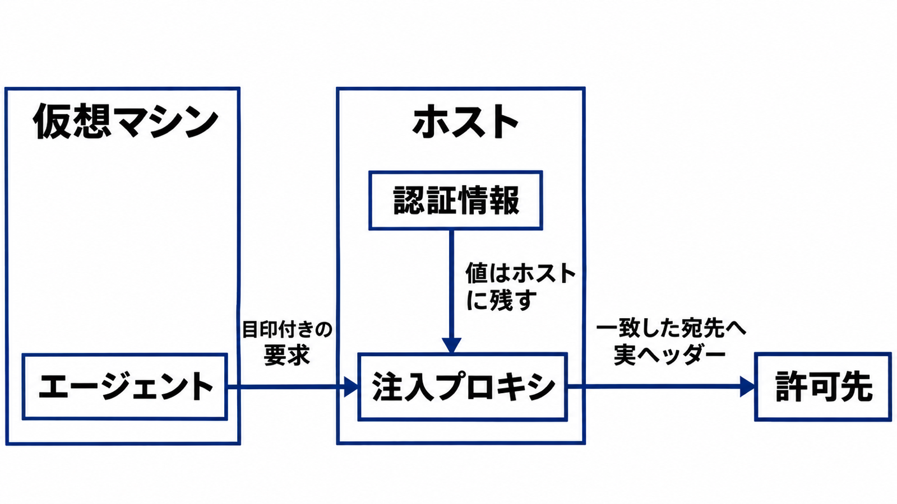

# ダイジェスト: 開発環境を隔離・コンテキスト・ガードレール・検証に分ける

[元記事](../../../../../articles/tech-dentsusoken-entry-2026-p5_20261128.md)

## ひとことで言うと

佐藤氏は、開発環境を隔離・コンテキスト・ガードレール・検証の四層に分けます。

## 核心ポイント

- 隔離はどこで動かすか、コンテキストは何を見せるか、ガードレールは逸脱を止めるか、検証は信じ方と人の判断です。
- 資格情報の注入が有効なとき、仮想マシンが見るのは目印だけです。
- OAuth の通過を許すと、本当のトークンが仮想マシンへ入ります。
- 自動で止めるのは、静的検査、型、依存の境界、秘密の検査、版の固定、単体テスト、性質の検査、ビルドです。
- sbx（操作コマンド）の 0.21.0 以上、0.43.0 未満は、目印以外の資格情報を要求に残します。非許可の宛先へトークンを付ける欠陥ではありません。

## メンタルモデル

左の枠が仮想マシン、中央の枠がホストです。矢印は目印の要求と、一致した宛先への本物のヘッダーです。

## 具体例

sbx run は、パスを省くと今のディレクトリを読み書きで載せます。エージェントは、その中の隠しファイルも読み書きできます。

## 適用と判断

向く場面:

- 指示の文を足すだけでは、並べた作業のポートとデータベースがぶつかるときです。
- 四層を一度にそろえず、困った層から足すときです。

確認項目:

- sbx の版は 0.43.0 以上ですか。
- 秘密は作業ディレクトリの外に置いていますか。
- 失敗出力からトークンと接続文字列を落としますか。
- 本番と共有のデータベースへは、CI からだけ触りますか。

## 限界・注意点

- 効果の数値は、書いた人の自己申告です。事故件数、削減率、遵守率の分母はありません。
- 著者の載せ方と使う版は、本文から決まりません。
- 画面の探索、差分ミューテーション、手元のトレース、別のモデルの見直しは、自動では止めません。
- 検証のコマンドが失敗した出力の末尾は、秘密を含み得ます。末尾で足りないとき開く部分も、そのまま返します。
- SSH の転送は既定で有効です。秘密鍵はホストに残り、ソケットを受けた処理は認証か署名を要求できます。

## 参考

- 元記事: [tech-dentsusoken-entry-2026-p5_20261128.md](../../../../../articles/tech-dentsusoken-entry-2026-p5_20261128.md)
- [佐藤太一「さくさく作れる毎日を支える、AI 時代の開発環境」](https://tech.dentsusoken.com/entry/2026/11/27/133501)
- [Docker Docs, Security model](https://docs.docker.com/ai/sandboxes/security/)
- [Docker Docs, Manage credentials](https://docs.docker.com/ai/sandboxes/configuration/credentials/)
- [目印以外の資格情報が残る欠陥（CVE-2026-105452）](https://nvd.nist.gov/vuln/detail/CVE-2026-105452)
